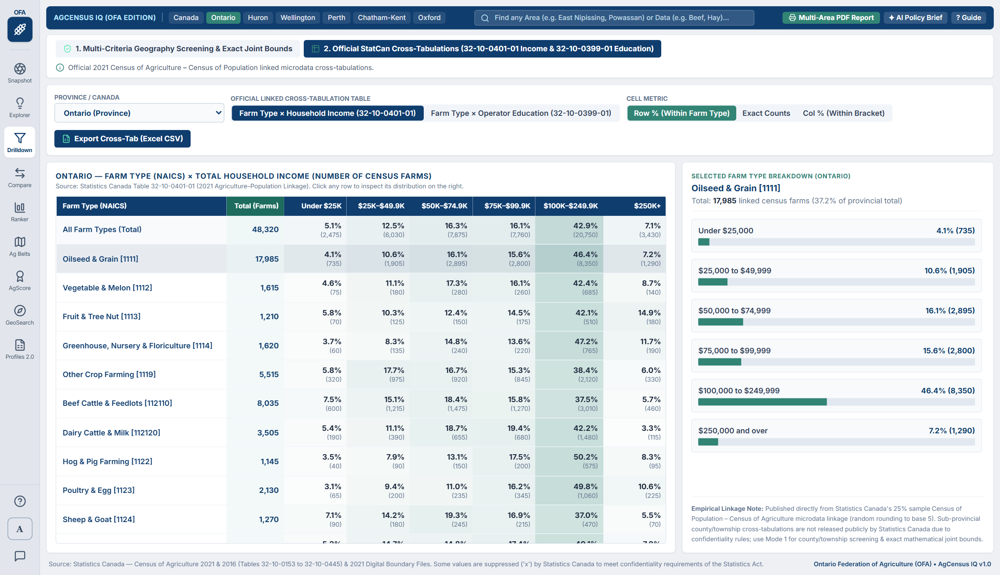
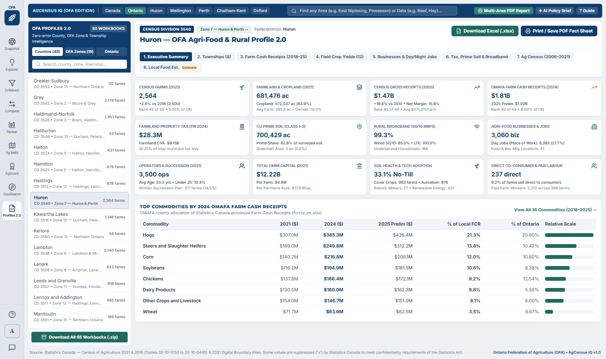
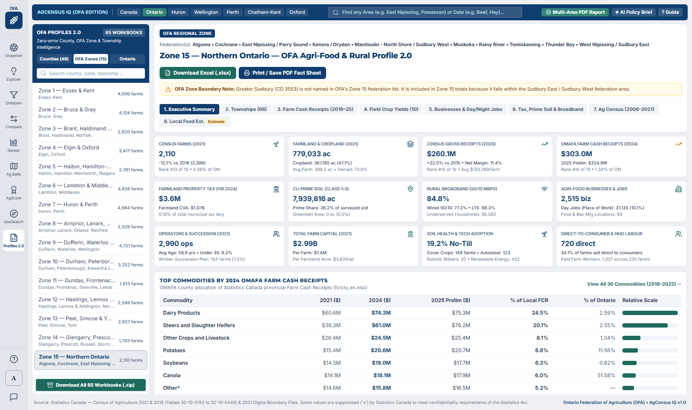

# AgCensus IQ (OFA Edition) — Plain-Language User Guide

**Prepared for:** Ontario Federation of Agriculture (OFA) Policy Analysts, Member Service Representatives (MSRs), County & Regional Federations, Municipal Leaders & Agricultural Researchers  
**Data Sources:** Statistics Canada — Census of Agriculture (`1976–2021`, `244` variables across `2,113` geographies), 2021 Digital Boundary Files, OMAFA Commodity Receipts & Field Crop Series (`2011–2025`), MMAH Financial Information Returns (`2021–2024`), LIO CLI Soils & Greenbelt, and ISED National Broadband Data

---

## Welcome to AgCensus IQ

**AgCensus IQ** is an interactive agricultural data and rural policy platform built for the **Ontario Federation of Agriculture (OFA)**. It turns dozens of complex Statistics Canada and provincial tables into clear community snapshots, 45-year historical trend charts, empirical regional screening, head-to-head comparisons, county and township leaderboards, publication-ready maps, and downloadable **OFA County & Zone Profile 2.0** Excel workbooks and PDF Fact Sheets.

You do not need any background in statistics, GIS mapping, or Statistics Canada table codes to use this tool. Every figure is grounded in empirical public data—never synthetic guesses—and this guide walks you through **every page and button in plain language**.

---

## Table of Contents

1. [Getting Around the Screen (Header Bar, Left Menu & Global Tools)](#1-getting-around-the-screen-header-bar-left-menu--global-tools)
2. [Tool 1: Ag Snapshot — Instant Community Farm Profile](#2-tool-1-ag-snapshot--instant-community-farm-profile)
3. [Tool 2: Ag Explorer — Historical Trends & Deep-Dive Charts (1976–2021)](#3-tool-2-ag-explorer--historical-trends--deep-dive-charts-19762021)
4. [Tool 3: Ag Drilldown — Empirical Screening, Exact Joint Bounds & Official Cross-Tabs](#4-tool-3-ag-drilldown--empirical-screening-exact-joint-bounds--official-cross-tabs)
5. [Tool 4: Ag Compare — Side-by-Side Comparison & "Most Similar County" Finder](#5-tool-4-ag-compare--side-by-side-comparison--most-similar-county-finder)
6. [Tool 5: Ag Ranker — Custom Leaderboards (Acres, Livestock Head, Dollars & Farms)](#6-tool-5-ag-ranker--custom-leaderboards-acres-livestock-head-dollars--farms)
7. [Tool 6: Ag Belts & Cluster Maps Studio — Publication & Social Media Map Generator](#7-tool-6-ag-belts--cluster-maps-studio--publication--social-media-map-generator)
8. [Tool 7: AgScore — Custom Multi-Metric Index & Opportunity Builder (0–100)](#8-tool-7-agscore--custom-multi-metric-index--opportunity-builder-0100)
9. [Tool 8: GeoSearch — Easy Area, OFA Zone & Data Finder (No Jargon Required)](#9-tool-8-geosearch--easy-area-ofa-zone--data-finder-no-jargon-required)
10. [Tool 9: OFA County & Zone Profiles 2.0 (`Profiles 2.0`)](#10-tool-9-ofa-county--zone-profiles-20-profiles-20)
11. [Global Tool A: Multi-Area PDF Report Builder](#11-global-tool-a-multi-area-pdf-report-builder)
12. [Global Tool B: AI Policy Brief & Speaking Notes Generator](#12-global-tool-b-ai-policy-brief--speaking-notes-generator)
13. [How to Use the Interactive Canada-Only Maps](#13-how-to-use-the-interactive-canada-only-maps)
14. [Plain-Language Glossary of Common Terms & Data Symbols](#14-plain-language-glossary-of-common-terms--data-symbols)

---

## 1. Getting Around the Screen (Header Bar, Left Menu & Global Tools)

No matter which tool you are using, the **Left Navigation Rail** and the **Top Header Bar** stay in place so you never get lost, and your active geography follows you automatically as you move between tools.

### The Left Navigation Rail (9 Core Tools)
On the far left edge of the screen, click any of the **9 icons** to switch tools immediately:
1. **Snapshot** — One-screen executive overview of a single province, region, county, or township across 8 analytical cards.
2. **Explorer** — Deep breakdown of any of the 10 agricultural variable categories, plus 45-year historical trajectories (`1976–2021`).
3. **Drilldown** — Empirical multi-criteria geography screening with exact mathematical joint bounds (`[Min–Max]`) plus official Statistics Canada cross-tabulations (*Farm Type × Income* and *Farm Type × Education*).
4. **Compare** — Head-to-head comparison of two geographies with standardized shared-trait explanations, an automatic *"Find Closest Match"* peer finder, and social media comparison cards.
5. **Ranker** — Sortable leaderboard and map ranking every county, region, or township across all **244** Census metrics by **Acres**, **Livestock Head**, **Dollars (\$)**, or **Farms**.
6. **Ag Belts** — Publication-ready `1800×1125` poster studio for Dominant Crop/Livestock Belts, Single-Stat Clusters, and All-Division Heat Maps.
7. **AgScore** — Custom 4-factor weighted index (`0–100`) with polarity inversion (`↑ High` / `↓ Low`), OFA policy presets, PDF printing, and CSV export.
8. **GeoSearch** — Plain-language finder for any town, township, county, OFA Federation, **OFA Regional Zone (`Zone 1`–`Zone 15`)**, or agricultural commodity.
9. **Profiles 2.0** — Complete agri-food & rural policy profiles, 9-tab Excel workbooks (`.xlsx`), and PDF Fact Sheets (`.pdf`) for all **49 Ontario Counties/Districts**, **15 OFA Regional Zones**, and **Ontario**.

At the bottom of the left rail are three helper icons: **`?` Guided Walkthrough**, **`A` AI Policy Brief**, and **Empirical Data Sources & Methodology**.

### The Top Header Bar (Always Available)
Across the top of the workspace, you have:
- **Global Search Omnibox (`Find any Town, Township, County, OFA Zone, or Farm Topic...`):** Type any community (*Goderich*, *Listowel*, *Powassan*), county (*Huron*, *Chatham-Kent*), **OFA Zone** (*`OFA Zone 7`*, *`Zone 15`*), or topic (*`dairy`*, *`tile drainage`*, *`solar`*, *`cover crops`*) to jump straight to that geography or metric—or combine multiple districts into a multi-area report.
- **Quick-Benchmark Shortcut Pills:** One-click buttons for *Canada*, *Ontario*, *Huron*, *Wellington*, *Perth*, *Chatham-Kent*, *Oxford*, and *Niagara*.
- **`Multi-Area PDF Report` Button:** Opens a custom report builder where you can combine multiple counties/townships into one printable briefing package with double-count-safe regional rollups.
- **`AI Policy Brief` Button:** Generates copy-ready executive speaking notes grounded 100% in official Statistics Canada tables (press `Esc` anytime to close).
- **`? Guide` Button:** Launches a step-by-step interactive tour tailored to whichever module is currently open.
- **Streamlit Cloud Direct Download Bar *(when hosted on Streamlit Cloud)*:** A compact expandable bar (`📥 OFA County & Zone Profiles 2.0 — Direct Excel (.xlsx), PDF Fact Sheet & Master ZIP Downloads`) sits right at the top of the browser window for one-click workbook, PDF, and 65-file `.zip` downloads.

---

## 2. Tool 1: Ag Snapshot — Instant Community Farm Profile

**When to use it:** You have a meeting with a County Federation, municipal council, or MPP/MP and need an accurate, one-screen profile of farming in a specific province, agricultural region, county, or township in seconds.

### How to Use Ag Snapshot Step by Step

1. **Pick Your Area (Top-Left `Geography` Card):**
   - Choose your **Geographic Level**: *Country*, *Provinces & Territories*, *Census Agricultural Regions (CAR)*, *Counties / Census Divisions (CD)*, or *Townships / Subdivisions (CCS)*.
   - Filter by province (e.g., *Ontario*) or type any town, township, county, or OFA Federation into the green Quick Search box.
2. **Read the 8 Executive Agricultural Cards:**
   - **Card 1 — Census Farms & Farmland:** Total 2021 farms, total farmland acres, average farm size, 2016–2021 % change badges, and Cropland vs. Pasture/Woodland share.
   - **Card 2 — Operators & Succession:** Average operator age, % female operators, % under 35 vs. 55+, and % of farms with a formal **Written Succession Plan**.
   - **Card 3 — Top Farm Types (NAICS):** Top 5 primary farm industries ranked by share of farms and exact farm counts.
   - **Card 4 — Land Tenure & Operating Structure:** Owned vs. rented/leased farmland share alongside Sole Proprietorships, Partnerships, and Family/Non-Family Corporations.
   - **Card 5 — Top Field Crops & Horticulture:** Top 5 crops by acreage in that specific area, plus Fruit acres, Field Vegetable acres, and Greenhouse square footage.
   - **Card 6 — Livestock, Poultry & Bees:** Total Cattle & Calves (Dairy vs. Beef cows), Pigs, Hens & Chickens, Sheep, and Honeybee colonies.
   - **Card 7 — Farm Revenues & Expenses:** Total Gross Farm Operating Revenues, Average Revenue & Expenses per Farm, Net Cash Operating Income per Farm, and Net Operating Margin (%).
   - **Card 8 — Farm Capital, $/Acre & Sustainability Tech:** Total Farm Capital, Land & Buildings value per acre (`$/acre`), and adoption shares for No-Till, Winter Cover Crops, Auto-Steer GPS, Renewable Energy, and Direct-to-Consumer Sales.
3. **Click `+` on Any Card to Deep-Dive:**
   - Every card has a **`+`** button in its top-right corner that opens that exact topic inside **Ag Explorer**.
4. **Open the Geographic Context & Peer Distance Map (`Click here to show map`):**
   - Highlights your selected boundary on an interactive map alongside the **12 closest peer geographies** ranked by distance (`km`). Press `Esc` or click `Click here to hide map` to close.

5. **Print a 1-Page Executive Factsheet:**
   - Click **`Export OFA County Factsheet`** / **`Print`** in the top header to print or save a clean PDF handout.

---

## 3. Tool 2: Ag Explorer — Historical Trends & Deep-Dive Charts (1976–2021)

**When to use it:** You want to inspect every sub-category within one of the 10 Census topics or trace structural farm trends across **10 Census waves (`1976–2021`)**.

### How to Use Ag Explorer Step by Step

1. **Select Your Geography & Variable Category (Left Column):**
   - Choose any geography at the top-left, then navigate the **10-Category Agricultural Variable Tree** and pick a specific sub-topic breakdown (`Characteristic Distribution` or `Aggregate Statistics`).
2. **Switch Between the 4 Visualization Views:**
   - **Horizontal Bars (Default):** Displays 2021 values alongside 2016 benchmarks and 5-year change badges (`+%` / `-%`), toggling between Percentages (`%`) and Exact Counts/Totals.
   - **Proportional Share / Adoption Gauges:** Displays proportional share slices for mutually exclusive categories (such as farm size classes or revenue brackets). When a category allows farms to report multiple items at once (e.g., *Precision Technologies* or *Soil Conservation Practices* summing above `100%`), Ag Explorer automatically switches to **individual `0–100%` adoption gauges** with an explanatory note so shares are never distorted.
   - **45-Year Historical Trajectory (`1976–2021`):** Plots multi-decade structural trends across `1976, 1981, 1986, 1991, 1996, 2001, 2006, 2011, 2016, and 2021`.
   - **Data Table & Excel CSV:** Displays exact figures, flags (`x`, `F`, `—`), and denominator units with one-click UTF-8 Excel CSV download.

3. **Verify the Denominator (`Base` Button) & Right-Hand Summary Panel:**
   - Click **`Base`** to view the exact Statistics Canada denominator (e.g., *Total Census Farms*, *Prepared Cropland Acres*, or *Total Operators*) and inspect paired aggregate statistics on the right.

---

## 4. Tool 3: Ag Drilldown — Empirical Screening, Exact Joint Bounds & Official Cross-Tabs

**When to use it:** You want to screen counties or townships across **multiple farm characteristics at once** without relying on synthetic independence guesses—or inspect Statistics Canada's official linked **Farm Type × Household Income** and **Farm Type × Operator Education** cross-tabulations.

Ag Drilldown provides **two rigorous empirical modes** toggled at the top of the workspace:

### Mode 1: Multi-Criteria Geography Screening & Exact Joint Bounds (Default)

1. **Choose Geographic Scope:** Select *Counties / Census Divisions (CD)* or *Townships / Subdivisions (CCS)* and filter to *Ontario*, any province, or *All of Canada*.
2. **Combine Up to 3 Empirical Filters & Minimum Share Thresholds (`Min %`):**
   - **Filter 1 — Farm Type (NAICS):** e.g., *Oilseed & Grain*, *Dairy Cattle & Milk*, *Beef Cattle*, *Greenhouse*, *Poultry & Egg*.
   - **Filter 2 — Gross Revenue Scale:** e.g., *Commercial Scale (`$500,000+`)* or any specific revenue bracket.
   - **Filter 3 — Operating Structure, Succession, Tech & Stewardship:** e.g., *Family Corporation*, *Written Succession Plan*, *Auto-Steer Guidance*, *Winter Cover Crops*, *Direct Sales*, or *Renewable Energy*.
3. **Read Exact Mathematical Joint Bounds (`[Min–Max]`):**
   - When a single filter is active, Drilldown shows the **exact published Statistics Canada count and % share**.
   - When 2 or 3 filters are active at the county/township level (where Statistics Canada publishes marginal totals rather than 3-way microdata), Drilldown never multiplies percentages synthetically. Instead, it screens geographies against your exact empirical thresholds and computes the **exact Fréchet–Hoeffding mathematical range** (`Guaranteed Min → Max Possible` farms and % share) that must hold regardless of correlation.
   - Use **`Max Bound`** vs. **`Min Floor`** above the map to shade and rank qualifying areas by either the upper bottleneck or guaranteed minimum overlap, while suppressed (`x` / `F`) areas are tracked transparently rather than coerced to zero.
4. **Export Visuals & Data:** Click **`Download Map (PNG)`** for a high-resolution composite heat map with non-overlapping callouts, or **`Download Ranks (Excel CSV)`** for the full screening table.

### Mode 2: Official StatCan Cross-Tabulations (`32-10-0401-01` & `32-10-0399-01`)

1. Click **`2. Official StatCan Cross-Tabulations (32-10-0401-01 Income & 32-10-0399-01 Education)`** in the top bar.
2. Toggle between **Farm Type × Total Household Income (`32-10-0401-01`)** and **Farm Type × Operator Educational Attainment (`32-10-0399-01`)** from Statistics Canada's 2021 Agriculture–Population Linkage for Canada or any province.
3. Switch cell display between **`Row % (Within Farm Type)`**, **`Exact Counts`**, and **`Col % (Within Bracket)`**, click any farm type row to inspect its distribution chart on the right, and click **`Export Cross-Tab (Excel CSV)`** to download.

---

## 5. Tool 4: Ag Compare — Side-by-Side Comparison & "Most Similar County" Finder

**When to use it:** You want a head-to-head comparison of any two counties, townships, regions, or provinces—or want to discover which other county in Ontario or Canada is **most structurally similar** to yours and why.

### How to Use Ag Compare Step by Step

1. **Pick Geography A & Geography B — or Auto-Find Peers:**
   - Select any two geographies manually, or click **`Find Closest Match`** / **`Most Alike Pair`** at the top. The similarity engine standardizes metrics across candidate peers (preserving missing/suppressed `x` and `F` cells rather than treating them as zero) to compute an objective **Similarity %** score.
2. **Read the Plain-English Shared-Trait Cards (*"Why These Counties Are Alike"*):**
   - Highlights the top scale-free structural traits that both areas share in common relative to peers.
3. **Scan Butterfly Bars & Green Winner Dots (`●`):**
   - Toggle between **Percentages (`%`)** and **Exact Counts / Totals**, filter by category, and scan the green winner dots (`●`) marking the higher value in each unsuppressed comparison pair.
4. **Export Ready-to-Share Deliverables:**
   - Click **`Download Social Graphic (PNG)`** (`1600×1000` card with side-by-side maps and similarity gauge), **`Print / Save PDF`**, or **`Download CSV`**.

---

## 6. Tool 5: Ag Ranker — Custom Leaderboards (Acres, Livestock Head, Dollars & Farms)

**When to use it:** You want to rank every county, region, province, or township across any of the **244** Census of Agriculture metrics—by **Acres**, **Livestock Head**, **Dollars (\$)**, **Farms**, or **% Share**.

### How to Use Ag Ranker Step by Step

1. **Choose Geographic Scope (`Geographies`):** Rank *Counties / Census Divisions (CD)*, *Townships / Subdivisions (CCS)*, *Agricultural Regions (CAR)*, or *Provinces*, filtered to *Ontario* or *All of Canada*.
2. **Filter by Unit Measure (`Variable & Unit Measure`):**
   - Click one of the **6 Unit Filter buttons** to narrow the **244** Census variables immediately:
     - **`All (244)`** — Every Census variable.
     - **`Acres`** — Total farmland, cropland, field crops, fruit, vegetables, and tillage acres.
     - **`Head / Herd`** — Cattle, dairy cows, beef cows, pigs, sheep, horses, poultry, bees, and average herd sizes.
     - **`Dollars ($)`** — Gross farm receipts, operating expenses, total farm capital, and `$/acre` values.
     - **`Farms`** — Number of farms reporting any commodity, revenue class, technology, or BMP.
     - **`Totals / Avgs`** — All physical volumes, dollar totals, and per-farm averages.
3. **One-Click `Switch Measure for This Topic` Pills:**
   - Flip any selected commodity (e.g., *Soybeans*, *Corn*, *Dairy*, *Pigs*) between **Acres / Head**, **Farms Reporting**, and **Per-Farm Average** in one click.
4. **Customize the `Extra Col:` Reference Column & Threshold Filters:**
   - Pair your ranked metric with *Auto (Paired Acres / Head / Farms)*, *Total Farmland*, *Land in Crops*, *Avg Farm Size*, *Gross Receipts*, *2016 Prior Value*, or *Total Farms*, and apply farm-count or percentage-share filters on the bottom-left.
5. **Export Reports:** Click **`Download Map & Graph (PNG)`**, **`Print / Save PDF`**, or **`Download Data (Excel CSV)`**.

---

## 7. Tool 6: Ag Belts & Cluster Maps Studio — Publication & Social Media Map Generator

**When to use it:** You want to create **editorial-quality `1800×1125` maps** for OFA social media posts, policy briefs, presentations, or reports across Ontario or all of Canada.

### The 3 Visual Map Modes

1. **`Dominant Belts`:** Colors each Census Division by its **#1 largest crop, farm type, or livestock species** (with built-in presets for *Major Field Crop Belts*, *NAICS Commodity Belts*, *Livestock Belts*, and *Horticulture Belts*).
2. **`Single-Stat Cluster`:** Highlights 5-tier quintile concentration clusters for any single metric across all **244** Census variables.
3. **`All-CD Heat Map`:** Shades every reporting division across 6 thermal tiers so viewers see the entire provincial or national production footprint.

### Customizing & Exporting Your Poster
- Switch between **`Ontario (Provincial)`** (with an automatic **Northern Ontario Districts inset**) and **`All of Canada (National)`**, or pick any individual province.
- Toggle **`Dark Editorial`** vs. **`Light Report`** themes, customize titles and non-overlapping perimeter leader callouts, and click **`Download Social Poster (PNG)`** or **`Download Data (CSV)`**.

---

## 8. Tool 7: AgScore — Custom Multi-Metric Index & Opportunity Builder (0–100)

**When to use it:** You want to combine up to **4 Census characteristics** with custom weights into a single standardized **`0–100` Composite Index** across counties, regions, or townships.

### How to Use AgScore Step by Step

1. **Try a 1-Click OFA Policy Preset or Customize Characteristics 1–4:**
   - Built-in presets include *Commercial Scale & Precision Ag Readiness*, *Soil Stewardship & Climate BMP Leadership*, *Generational Renewal & Young Farmer Vitality*, and *Farmland Capital Intensity & Tenure Pressure*.
2. **Set Weights (`0.0–1.0`), Polarity (`↑ High` vs. `↓ Low`), & Min/Max % Filters:**
   - Adjust each slot's **`Weight`** (`0.0` to `1.0`) and optional **`Min (%)` / `Max (%)`** screening bounds.
   - Click the **`↑ High` / `↓ Low`** polarity toggle at the top-right of any slot card when **lower values should score higher** (for example, younger *Average Operator Age* or lower *Rented Farmland Pressure*).
3. **Inspect Color-Coded Score Bands & Export:**
   - Qualifying geographies are standardized via Z-scores into normal percentiles (`0–100`) and color-coded into **Leading (`90–100`, Green)**, **Strong (`70–90`, Blue)**, **Moderate (`50–70`, Amber)**, and **Low (`<50`, Red)**.
   - Click **`Print / PDF`** or **`Export CSV`** in the *Ranked Geographies* header to share or analyze the full multi-factor scorecard.

---

## 9. Tool 8: GeoSearch — Easy Area, OFA Zone & Data Finder (No Jargon Required)

**When to use it:** You want to look up any town, township, county, OFA Federation, or **OFA Regional Zone (`Zone 1`–`Zone 15`)** in everyday language, check live Census numbers on the spot, or launch a multi-area combined report.

### Key Ways to Search in GeoSearch

1. **Search Communities, Federations, or OFA Zones (Left Panel):**
   - Type any town or village (*Goderich*, *Listowel*, *Powassan*, *Leamington*, *Swift Current*), township (*Mapleton*, *South Huron*), OFA Federation (*East Nipissing-Parry Sound*), or **OFA Regional Zone** (*`OFA Zone 7`*, *`Zone 15`*, *`OFA Z01`*) to see its exact Statistics Canada hierarchy path, OFA Federation badge, and farm count.
   - Click one-click action buttons to open that area in **Snapshot**, **Explorer**, **Compare**, or **Multi-Area Combined Report**.
2. **Instant Agricultural Topic Search (Right Panel):**
   - Search any plain-English keyword (*`dairy`*, *`maple`*, *`solar`*, *`no-till`*, *`cash rent`*, *`young farmers`*, *`honeybees`*) across all **244** Census characteristics to view immediate `2021` and `2016` figures for your focused area.

---

## 10. Tool 9: OFA County & Zone Profiles 2.0 (`Profiles 2.0`)

**When to use it:** You need a complete, error-free agri-food and rural policy profile, a downloadable 9-tab Excel workbook (`.xlsx`), or an executive PDF Fact Sheet (`.pdf`) for any of Ontario's **49 Counties/Districts**, **15 OFA Regional Zones**, or **Ontario**—replacing and expanding OMAFA's legacy County Profile spreadsheets.

### How to Use OFA County & Zone Profiles 2.0

1. Click **`Profiles 2.0`** on the left navigation rail.
2. In the left selector rail, filter between **`Counties (49)`**, **`OFA Zones (15)`**, and **`Ontario`**, or search by county, federation, or township name. *(Note: Greater Sudbury is included in OFA Zone 15 with an explicit footnote, and Stormont, Dundas & Glengarry is split cleanly at the township level between Zone 11 and Zone 14 per the December 2025 OFA Directory.)*
3. Explore the **8 interactive sub-tabs**:
   - **`1. Executive Summary`** — 12 headline KPI cards plus top commodities by OMAFA Farm Cash Receipts.
   - **`2. Townships`** — Side-by-side table of every township (`CCS`) in the county or OFA Zone across farms, cropland, gross receipts, net margin, succession plans, 2024 farmland property taxes, 50/10 Mbps broadband, and agri-food businesses.
   - **`3. Farm Cash Receipts (2018–25)`** — Pairs empirical Census Gross Farm Receipts (`2015` & `2020`) with OMAFA's 36-commodity County Farm Cash Receipts series (`2018–2025`).
   - **`4. Field Crop Yields`** — Seeded area, harvested area, yield, 5-year rolling average yield, and production in imperial units and metric tonnes across 12 major field crops.
   - **`5. Businesses & Day/Night Jobs`** — Algebraically verified Canadian Business Counts (`Dec 2016–2023`) plus Place-of-Work (**Day**) vs. Resident (**Night**) agri-food workforce and net commuter inflows across all 49 counties and 15 OFA Zones.
   - **`6. Tax, Prime Soil & Broadband`** — MMAH FIR Schedule 26A farmland assessment (`CVA`) and property taxes (`2021–2024`), CLI Class 1–3 prime soil acres, Greenbelt acres, and ISED 50/10 Mbps broadband coverage.
   - **`7. Ag Census (2006–2021)`** — Searchable **609-row** 4-census historical table (`2006, 2011, 2016, 2021`) with **zero** spreadsheet formula errors, repaired StatCan `32-10-0380-01` Renewable Energy rows, and 7 repaired 2021 StatCan commodity/unit blocks (click **`Show All 609 Rows`** anytime to expand the full un-truncated table).
   - **`8. Local Food Est.`** — Clearly badged **Illustrative Estimates** of household food spending and local food production context (keeping `acres` and `head` strictly separate).
4. **Download Workbooks, Fact Sheets & Master ZIPs:**
   - Click **`Download Excel (.xlsx)`** (`~63 KB` 9-tab workbook), **`Download PDF Fact Sheet`**, **`All 65 Excel Workbooks (.zip)`**, or **`All 65 PDF Fact Sheets (.zip)`** (or use the top `📥 OFA County & Zone Profiles 2.0` bar when running on Streamlit Cloud).

---

## 11. Global Tool A: Multi-Area PDF Report Builder

**When to use it:** You want to combine multiple counties, townships, or regions into a single formatted briefing report with automatic regional rollups.

1. Click **`Multi-Area PDF Report`** in the top header bar (or launch directly from GeoSearch / Omnibox).
2. Add or remove geographies—nested child townships inside an already-selected parent county are automatically flagged so totals never double-count farms or acres, and intensive metrics (like average age or net margin %) are aggregated using true denominator-weighted formulas rather than simple averages.
3. Choose your report sections and click **`Print / Save PDF Report`** or **`Export Combined CSV`**.

---

## 12. Global Tool B: AI Policy Brief & Speaking Notes Generator

**When to use it:** You need instant, citation-backed executive bullets for a briefing memo, municipal deputation, board update, or media interview.

1. Select any geography and click **`AI Policy Brief`** in the top header (or **`A`** on the bottom-left rail).
2. Review the 5 evidence-grounded paragraphs covering Farm Structure, Economic Output & Margins, Farmland Capital & Tenure, Operator Demographics & Succession, and Precision Tech & Soil Stewardship—each citing its exact Statistics Canada table number.
3. Click **`Copy Policy Briefing`** to paste directly into Word, Outlook, or PowerPoint.

---

## 13. How to Use the Interactive Canada-Only Maps

Every interactive map in **Snapshot**, **Drilldown**, **Ranker**, and **AgScore** includes:
- **`Canada Only` Vector Canvas (Default) vs. `Context Base`:** Focuses 100% of screen space on Canadian agricultural boundaries, with optional background map tiles.
- **One-Click Regional Focus Pills:** Jump to **`All Canada`**, **`West`**, **`ON / QC`**, **`Atlantic`**, or **`South ON + Inset`** (which pairs Southern Ontario with a dedicated interactive **Northern Ontario Districts inset**).
- **Plain-English Names for Numbered Prairie & NL Divisions:** Automatically enriches `"Division No. 1"`–`"Division No. 23"` with hub cities (e.g., `Division No. 8 (Red Deer / Lacombe / Ponoka)` or `Division No. 11 (Saskatoon / Outlook North)`).
- **`#1`, `#2`, `#3` Leader Pins, Live Bottom Spotlight Bar, & `Accessible` Palette Toggle.**

---

## 14. Plain-Language Glossary of Common Terms & Data Symbols

| Term or Symbol | What It Means in Plain Language |
| :--- | :--- |
| **Census Farm** | Any agricultural operation producing crops, livestock, poultry, greenhouse/nursery products, maple syrup, or honey intended for sale. |
| **CD (Census Division)** | **County, Regional Municipality, Single-Tier City, or Northern District** (`49` in Ontario; `282` agricultural CDs across Canada). |
| **CCS (Census Consolidated Subdivision)** | **Township or Lower-Tier Municipality** inside a county (`414` in Ontario; `1,748` across Canada). |
| **CAR (Census Agricultural Region)** | **Sub-Provincial Farming Region** grouping neighbouring counties (`5` in Ontario: *Southern, Western, Central, Eastern,* and *Northern Ontario*; `72` across Canada). |
| **OFA Regional Zones (`Zone 1`–`Zone 15`)** | The 15 official Ontario Federation of Agriculture governance zones grouping Ontario's county/regional federations (searchable directly as `OFA Zone 1`–`OFA Zone 15` and profiled in **Tool 9: Profiles 2.0**). |
| **NAICS (Dominant Farm Type)** | Classifies each farm by the commodity group generating **more than 50% of its estimated gross agricultural receipts** (e.g., *Oilseed & Grain [1111]*, *Dairy Cattle & Milk [112120]*). |
| **Exact Joint Bounds (`[Min–Max]`)** | In **Ag Drilldown**, the mathematically guaranteed minimum and maximum possible number (and %) of farms meeting 2 or 3 criteria simultaneously based on published Statistics Canada marginals—avoiding synthetic multiplication assumptions. |
| **`x` — `x (Suppressed)`** | **Confidentiality Suppression:** Hidden by Statistics Canada under the federal *Statistics Act* because too few farms report in that area to protect individual farm privacy. Never treated as zero. |
| **`F` — `F (Unreliable)`** | **Quality Suppression:** Marked `'F'` (*"too unreliable to be published"*) by Statistics Canada's 2021 Census quality rules when sampling/imputation dispersion is too high for reliable release. |
| **`—` / `N/A` (Not Applicable)** | **Zero Reporting Denominator:** Shown on per-farm averages or ratios when `0` farms in a township report that specific commodity (e.g., average pig herd size where `0` farms raise pigs), distinguishing true absence from `'x'` suppression. |
| **`16–21 Δ` (Change)** | Percentage growth (`+`) or decline (`-`)—or percentage-point shift (`pts`) for rate metrics—between the **2016** and **2021** Censuses of Agriculture. |
