# AgCensus IQ (OFA Edition) — Plain-Language User Guide

**Prepared for:** Ontario Federation of Agriculture (OFA) Policy Analysts, Field Staff, County Federations, Municipal Leaders & Agricultural Researchers  
**Data Source:** Statistics Canada — Census of Agriculture (1976–2021) & 2021 Digital Boundary Files

---

## Welcome to AgCensus IQ

**AgCensus IQ** is an interactive agricultural data platform built for the **Ontario Federation of Agriculture (OFA)**. It turns thousands of pages of complex Statistics Canada Census of Agriculture tables into easy-to-read community profiles, historical trend charts, side-by-side comparisons, county rankings, and publication-ready maps.

You do not need any background in statistics, GIS mapping, or Statistics Canada table codes to use this tool. This guide walks you through **every page and button in plain language**, with step-by-step instructions and screenshots.

---

## Table of Contents

1. [Getting Around the Screen (Header Bar, Left Menu & Global Tools)](#1-getting-around-the-screen-header-bar-left-menu--global-tools)
2. [Tool 1: Ag Snapshot — Instant Community Farm Profile](#2-tool-1-ag-snapshot--instant-community-farm-profile)
3. [Tool 2: Ag Explorer — Historical Trends & Deep-Dive Charts (1976–2021)](#3-tool-2-ag-explorer--historical-trends--deep-dive-charts-19762021)
4. [Tool 3: Ag Drilldown — Proportional Treemaps & Sub-Region Heat Maps](#4-tool-3-ag-drilldown--proportional-treemaps--sub-region-heat-maps)
5. [Tool 4: Ag Compare — Side-by-Side Comparison & "Most Similar County" Finder](#5-tool-4-ag-compare--side-by-side-comparison--most-similar-county-finder)
6. [Tool 5: Ag Ranker — Custom Leaderboards (Acres, Livestock Head, Dollars & Farms)](#6-tool-5-ag-ranker--custom-leaderboards-acres-livestock-head-dollars--farms)
7. [Tool 6: Ag Belts & Cluster Maps Studio — Publication & Social Media Map Generator](#7-tool-6-ag-belts--cluster-maps-studio--publication--social-media-map-generator)
8. [Tool 7: AgScore — Custom Multi-Metric Index & Opportunity Builder](#8-tool-7-agscore--custom-multi-metric-index--opportunity-builder)
9. [Tool 8: GeoSearch — Easy Area & Data Finder (No Jargon Required)](#9-tool-8-geosearch--easy-area--data-finder-no-jargon-required)
10. [Global Tool A: Multi-Area PDF Report Builder](#10-global-tool-a-multi-area-pdf-report-builder)
11. [Global Tool B: AI Policy Brief & Speaking Notes Generator](#11-global-tool-b-ai-policy-brief--speaking-notes-generator)
12. [How to Use the Interactive Canada-Only Maps](#12-how-to-use-the-interactive-canada-only-maps)
13. [Plain-Language Glossary of Common Terms](#13-plain-language-glossary-of-common-terms)

---

## 1. Getting Around the Screen (Header Bar, Left Menu & Global Tools)

No matter which tool you are using, the **Left Navigation Rail** and the **Top Header Bar** stay in place so you never get lost.

### The Left Navigation Rail (8 Tools)
On the far left edge of the screen, click any of the **8 icons** to switch between tools:
1. **Snapshot** — One-page overview of a single province, region, county, or township.
2. **Explorer** — Detailed breakdown of all variables in a category, plus 45-year historical line charts (1976–2021).
3. **Drilldown** — Visual breakdown showing how a province or county is divided among sub-regions and farm types.
4. **Compare** — Side-by-side comparison of 2 to 5 areas, plus an automatic *"Find Most Similar Counties"* matcher.
5. **Ranker** — Sortable leaderboard and map ranking every county or township by **Acres**, **Livestock Head**, **Dollars (\$)**, or **Farms**.
6. **Ag Belts** — Publication-ready social media poster generator for Crop/Livestock Belts, Top Clusters, and All-Division Heat Maps.
7. **AgScore** — Custom weighted scorecard to rank counties across multiple priorities at once.
8. **GeoSearch** — Beginner-friendly search page where you can find any town/county by name or click a plain-English question.

### The Top Header Bar (Always Available)
Across the top of the screen, you will find:
- **Quick Area Search Box (`Search Ontario counties, townships, or Canada...`):** Type any county, district, or township name (for example, *Huron*, *Chatham-Kent*, *Perth East*, or *Niagara*) and click a result to jump straight to that community.
- **Active Geography Pill:** Shows which area you are currently viewing, its geographic level (e.g., *County / Census Division*), and its total farm count.
- **Saved Bookmarks (`Saved (X)`):** Click the star icon next to your active area to bookmark your favourite counties so you can switch between them in one click.
- **`Multi-Area PDF Report` Button:** Opens a custom report builder where you can pick multiple counties and specific farm statistics to print a clean, multi-page briefing packet.
- **`AI Policy Brief` Button:** Generates instant, copy-ready executive bullet points, economic highlights, and speaking notes for whatever area is on your screen.
- **`? Guide` Button:** Launches an interactive on-screen step-by-step tour of the page you are currently viewing.

---

## 2. Tool 1: Ag Snapshot — Instant Community Farm Profile

**When to use it:** You have a meeting with a local federation, municipal council, or MPP/MP and need a complete, factual overview of agriculture in a specific county, township, or province in seconds.

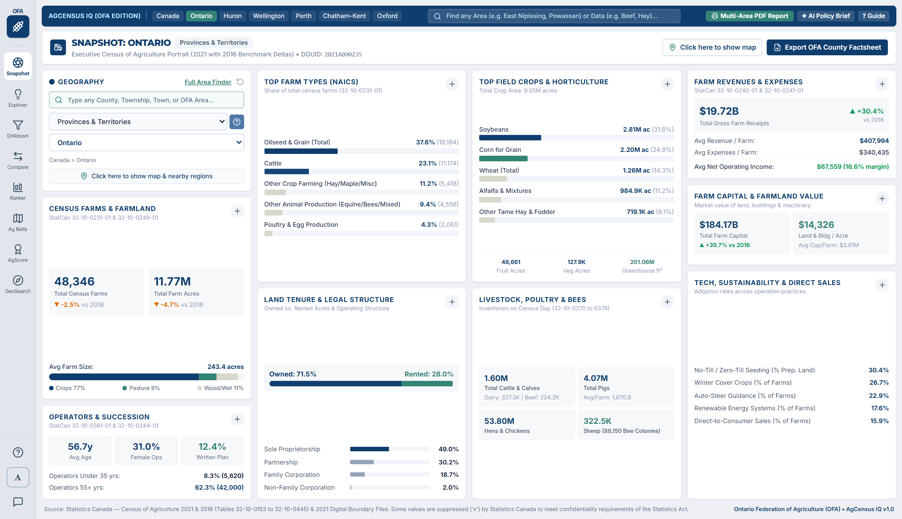

### How to Use Ag Snapshot Step by Step

1. **Pick Your Area (Left Sidebar — `GEOGRAPHIES`):**
   - Use the **Boundary Level** dropdown to choose how broad or local you want to look:
     - **National (Canada)** — All of Canada combined.
     - **Provinces & Territories** — Ontario, Alberta, Quebec, etc.
     - **Agricultural Regions (CAR)** — Broad farming zones such as *Southern Ontario*, *Western Ontario*, or *Central Ontario*.
     - **Counties / Census Divisions (CD)** — All 49 Ontario counties/regions (e.g., *Huron*, *Middlesex*, *Wellington*) or any of the 293 Census Divisions across Canada.
     - **Townships / Municipalities (CSD)** — Individual lower-tier townships and municipalities (e.g., *Mapleton*, *North Perth*, *Zorra*).
   - Use the **Province / Territory Filter** (set to *Ontario* by default) to narrow the list, then pick your specific county or township from the third dropdown.
2. **Choose Which Category to Display (`VARIABLE`):**
   - Switch between **Counts & Share** (number of farms and % of total farms) and **Aggregate Stats** (total acres, head of livestock, and dollar values).
   - Pick any of the **8 Census Categories** from the dropdown (such as *1. Farm Types & Industry (NAICS)*, *3. Livestock & Poultry Inventories*, or *5. Farm Revenues, Capital & Expenses*).
3. **Read the 4 Headline Summary Cards (Top of Center Panel):**
   - At a glance, you see **Total Farms (2021)**, **Total Farm Area (Acres)**, **Est. Gross Farm Receipts (\$)**, and **Dominant Farm Type**, each with a green or orange badge showing how much it grew or shrank between **2016 and 2021**.
4. **Compare Against a Benchmark (`Benchmark:` Dropdown):**
   - In the top-right corner of the data table, change the **Benchmark** dropdown to compare your county side-by-side against **Ontario**, **Canada**, or its parent **Agricultural Region**.
5. **View on the Interactive Map (`Click here to show map`):**
   - Click the **`Click here to show map`** button in the top-left panel to open an interactive map highlighting your selected region and surrounding counties.

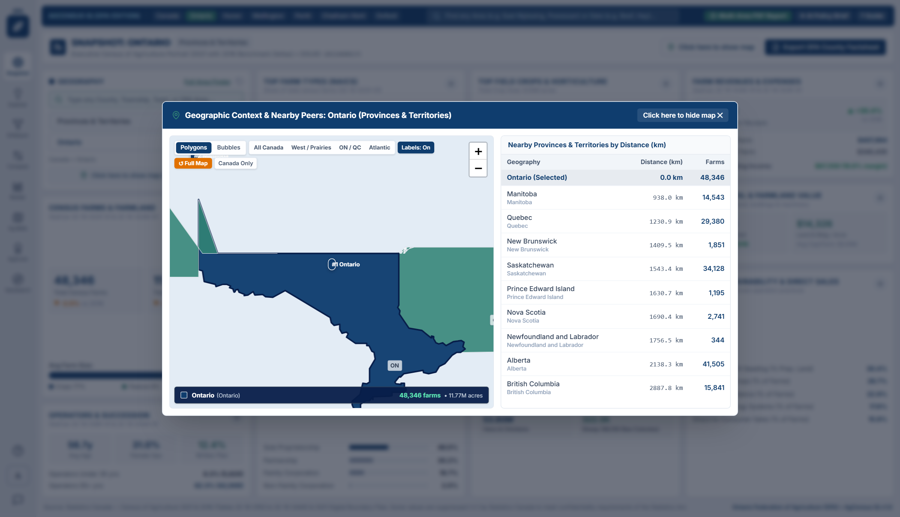

6. **Export Your Profile:**
   - Click **`Print / Save PDF`** (top right) for a formatted 1-page community handout, **`Download Snapshot PNG`** for a crisp image slide, or **`Download Data (Excel CSV)`** to open the numbers in Microsoft Excel.

---

## 3. Tool 2: Ag Explorer — Historical Trends & Deep-Dive Charts (1976–2021)

**When to use it:** You want to see how every metric within a topic compares inside a region, or you want to see how farming has changed over the last **45 years (1976 to 2021)**.

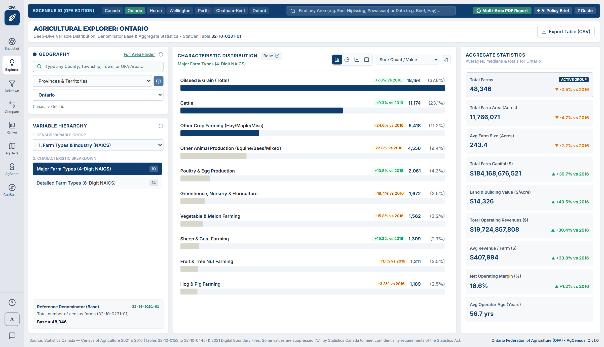

### How to Use Ag Explorer Step by Step

1. **Select Your Geography and Category (Left Sidebar):**
   - Pick your province, county, or township on the left, then select a **Variable Category** (for example, *2. Land Use & Farm Area Size* or *4. Field Crops, Hay & Horticulture*).
2. **Switch Between the 3 Chart Views (Top-Right of Center Panel):**
   - **Horizontal Bar Chart Icon (Default):** Ranks every variable in the category from largest to smallest, showing the 2021 count, percentage share, and 2016–2021 change badge.
   - **Donut / Pie Chart Icon:** Shows how the category breaks down into proportional slices (great for visualizing farm size tiers, operator age groups, or revenue brackets).
   - **Historical Time-Series Icon (`1976–2021`):** Opens a 10-census historical trajectory chart showing long-term structural trends across **1976, 1981, 1986, 1991, 1996, 2001, 2006, 2011, 2016, and 2021**.

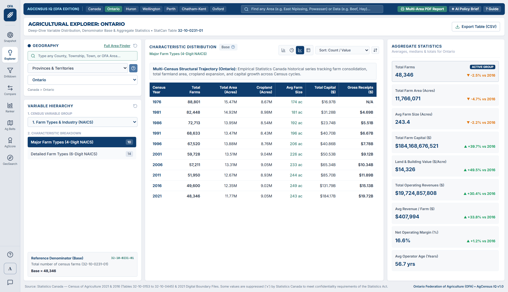

3. **Compare 2021 vs. 2016 Bars:**
   - In the left sidebar under **OPTIONS**, check **`Compare with 2016 Census`** to display dual-year comparison bars for every line item.
4. **Filter Out Small Items:**
   - Use the **Minimum Share (%)** slider or the **Quick Filter Variables** search box on the left to hide minor categories and focus on the biggest drivers.
5. **Download Charts or Data:**
   - Click **`Download Chart PNG`** to save the chart as an image for a presentation, or **`Download Data (Excel CSV)`** to export the table.

---

## 4. Tool 3: Ag Drilldown — Proportional Treemaps & Sub-Region Heat Maps

**When to use it:** You want to see how a larger region (like *Ontario* or *Canada*) breaks down across its constituent counties/sub-regions, both as a proportional block chart (**Treemap**) and a geographic **Heat Map**.

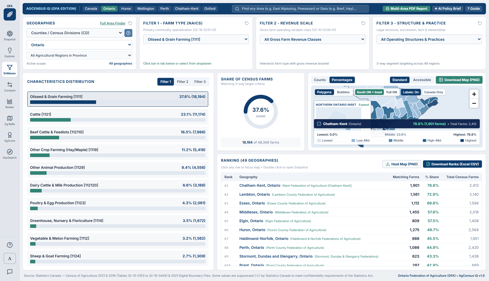

### How to Use Ag Drilldown Step by Step

1. **Choose Your Parent Region and Sub-Region Level (Left Sidebar):**
   - Pick your **Parent Geography** (e.g., *Ontario* or *All of Canada*) and choose what level to break it down into (e.g., *Counties / Census Divisions*).
2. **Choose What the Treemap Boxes Represent (`TREEMAP VIEW MODE`):**
   - **`Variable Breakdown`:** Shows how the selected region divides across different farm types, crops, or livestock categories.
   - **`Sub-Geography Breakdown`:** Shows which counties or townships make up the largest share of the selected metric (for example, which Ontario counties account for the most *Oilseed & Grain* farms).
3. **Explore the Paired Right-Hand Heat Map:**
   - The right-hand panel automatically maps every county or sub-region using a color scale from **Lowest** to **Highest**, with `#1`, `#2`, and `#3` leader badges pinned directly onto the top-producing regions.
4. **Export High-Resolution Visuals:**
   - Click **`Download Map & Graph (PNG)`** in the top-right bar to save a high-DPI composite poster combining the Treemap, Ranked Table, and Regional Heat Map (with non-overlapping leader callouts).

---

## 5. Tool 4: Ag Compare — Side-by-Side Comparison & "Most Similar County" Finder

**When to use it:** You want to compare **2 to 5 counties, townships, or provinces side-by-side**, or you want the tool to automatically find which other counties in Ontario or Canada are most similar to yours.

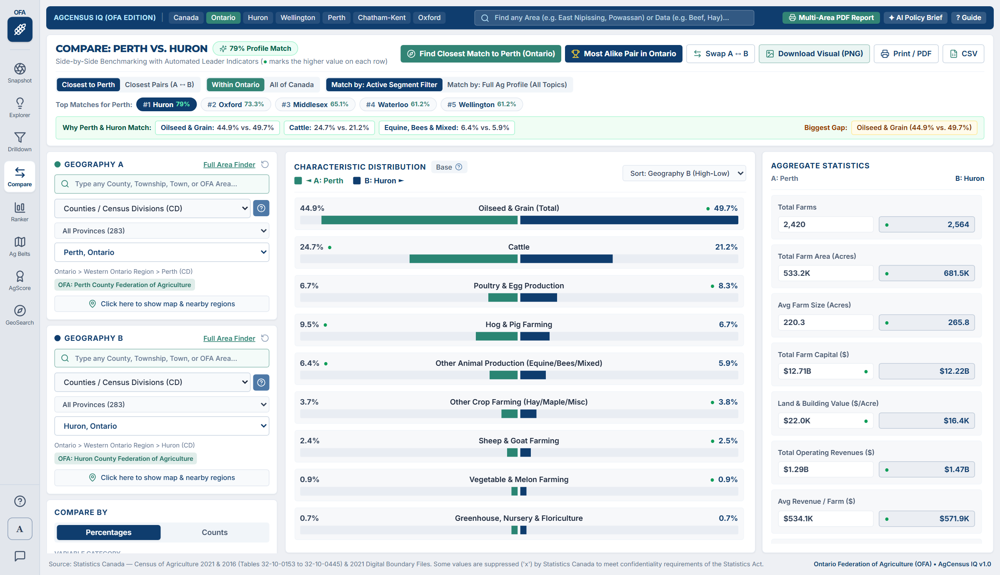

### How to Use Ag Compare Step by Step

1. **Pick Your Primary Target Area (`1. PRIMARY TARGET GEOGRAPHY`):**
   - Select the main county, township, or province you are studying (for example, *Huron*, *Middlesex*, or *Ontario*).
2. **Add Comparison Areas Manually or Automatically (`2. ADD COMPARISON AREAS`):**
   - **Option A — Automatic "Find Peer Matches" Button:** Click **`Auto-Fill Top 3 Most Similar`**! The tool compares your county's farm commodity mix, average farm size, and revenue structure against every other county and automatically selects the closest agricultural peers (showing a **Similarity % score**, such as `94% Match`).
   - **Option B — Pick Any Area Manually:** Search or choose up to 4 additional counties, townships, or provinces from the dropdown to compare side-by-side.
3. **Switch Between Table, Bar Chart, and Radar Fingerprint Views:**
   - **Comparison Table:** Displays every variable row-by-row across all selected areas, automatically highlighting the highest value in each row.
   - **Grouped Bar Chart:** Visualizes side-by-side bars for the top metrics in your chosen category.
   - **Agricultural Fingerprint (Radar Chart):** Overlays the structural shape of each county so you can immediately see where two counties are alike and where they differ.
4. **Download a Social Media Comparison Graphic:**
   - Click **`Download Social Graphic (PNG)`** to generate a ready-to-share comparison card for presentations, newsletters, or social media.

---

## 6. Tool 5: Ag Ranker — Custom Leaderboards (Acres, Livestock Head, Dollars & Farms)

**When to use it:** You want to answer questions like *"Which counties in Ontario have the most acres of soybeans?"*, *"Where are the largest cattle herds in Canada?"*, or *"Which townships grew the fastest in gross farm receipts?"*

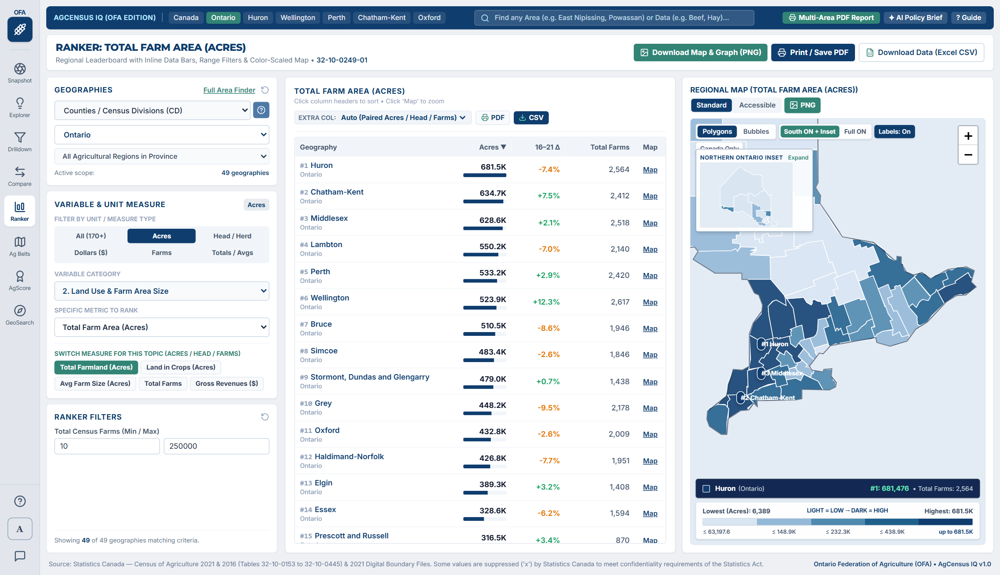

### How to Use Ag Ranker Step by Step

1. **Choose Which Geographic Level to Rank (`GEOGRAPHIES`):**
   - Select **Counties / Census Divisions (CD)**, **Townships / Municipalities (CSD)**, **Agricultural Regions (CAR)**, or **Provinces**, and filter by **Ontario** or **All of Canada**.
2. **Filter by Unit Measure (`1. FILTER BY UNIT / MEASURE TYPE`):**
   - Instead of hunting through 170+ variables, click one of the **6 Unit Filter buttons** to immediately show only metrics measured in that unit:
     - **`All (170+)`** — Every metric in the Census.
     - **`Acres`** — Crop acreages, total farmland, cropland, pasture, and conservation tillage acres.
     - **`Head / Herd`** — Total livestock head counts and average herd/flock sizes (cattle, dairy cows, pigs, sheep, poultry).
     - **`Dollars ($)`** — Gross farm receipts, total farm capital, operating expenses, and average revenue per farm.
     - **`Farms`** — Number of farms reporting each commodity, practice, or technology.
     - **`Totals / Avgs`** — All physical volumes, acres, head counts, dollar totals, and per-farm averages.
3. **Quick-Switch Between Paired Measures (`SWITCH MEASURE FOR THIS TOPIC`):**
   - Whenever you pick a commodity (for example, *Soybeans* or *Cattle*), green quick-switch pills appear right below the dropdown so you can toggle with **one click** between **Total Acres / Total Head**, **Farms Reporting**, and **Average Herd/Crop Size** for that exact same commodity.
4. **Customize the Extra Reference Column (`EXTRA COL:` Dropdown Above the Table):**
   - Above the leaderboard table, use the **`EXTRA COL:`** dropdown to choose what extra context column appears alongside your main ranking:
     - *Auto (Paired Acres / Head / Farms)* — Automatically shows Farm Count when you rank by Acres/Head, or Acres/Head when you rank by Farms!
     - *Total Farmland (Acres)*, *Land in Crops (Acres)*, *Avg Farm Size (Acres)*, *Gross Farm Receipts (\$)*, *Avg Revenue / Farm (\$)*, or *Total Farms (2021)*.
5. **Sort by Any Column & Filter by Range:**
   - Click any column header (**Count / Value**, **%**, **16–21 Change**, or the **Extra Column**) to sort ascending or descending.
   - Click **`Map`** on any row to zoom the right-hand map directly to that county or township.

---

## 7. Tool 6: Ag Belts & Cluster Maps Studio — Publication & Social Media Map Generator

**When to use it:** You want to create **high-impact, publication-ready maps** for social media posts, OFA policy briefs, board decks, or reports—showing either dominant crop/livestock belts or a full heat map across every county in Ontario or Canada.

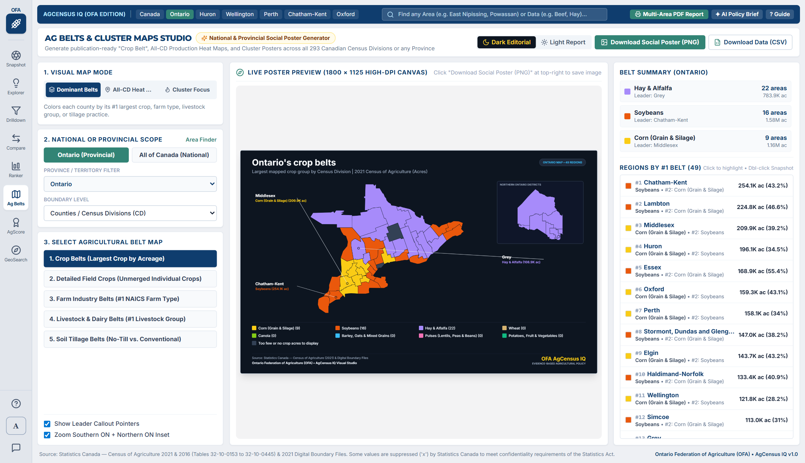

### Understanding the 3 Visual Map Modes (`1. VISUAL MAP MODE`)

1. **`Dominant Belts` (Multi-Commodity Winner per County):**
   - Colors each county by its **#1 largest crop or farm type** (for example, *Corn*, *Soybeans*, *Wheat*, *Hay & Alfalfa*, or *Canola*), creating classic "Crop Belt" or "Livestock Belt" maps.
2. **`Top Cluster Focus` (Single-Commodity Hotspot Map):**
   - Highlights the core production cluster for a single crop or livestock metric so viewers can immediately spot where an industry is concentrated.
3. **`All-CD Heat Map` (Every County Colored from Lowest to Highest):**
   - Colors **every single reporting county across Ontario or Canada** using a 5-tier color scale (*Lowest* to *Highest*) so you can see **all regions where production takes place**, from major heartlands to emerging production areas.

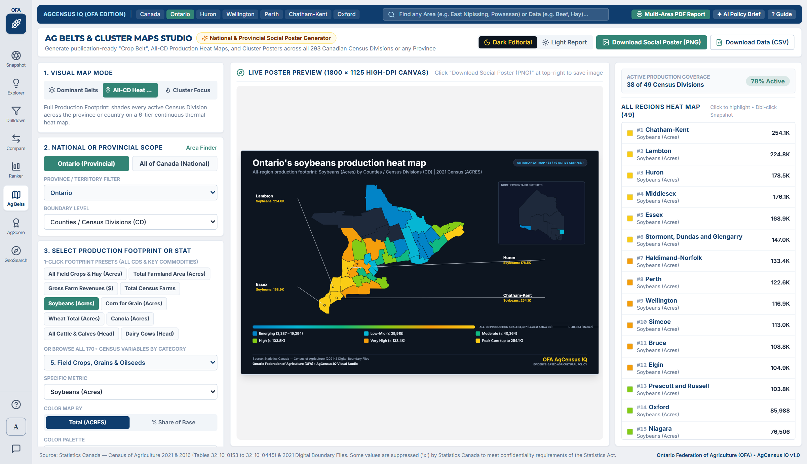

### How to Customize & Export Your Poster

1. **Choose Scope (`2. NATIONAL OR PROVINCIAL SCOPE`):**
   - Click **`Ontario (Provincial)`** (which automatically includes a dedicated **Northern Ontario Districts inset box** so both Southern and Northern Ontario are clearly visible) or **`All of Canada (National)`**, or pick any individual province from the dropdown.
2. **Choose Your Belt Preset or Specific Metric (`3. SELECT COMMODITY OR STAT TO MAP`):**
   - In *Dominant Belts* mode, pick from presets like **Major Field Crop Belts (Acres)**, **Broad Commodity Belts (NAICS Farm Types)**, **Livestock Belt (Dominant Herd)**, or **Fruit, Berry & Vegetable Belts**.
   - In *Top Cluster Focus* or *All-CD Heat Map* mode, pick any specific crop, livestock species, technology, or financial metric, and choose whether to color by **Total (Acres / Head / Farms)** or **% Share of Base**, plus your preferred **Color Palette** (*Warm Amber–Gold*, *OFA Emerald Green*, *Viridis Colorblind-Safe*, *Sunset Red–Orange*, or *Cool Ocean Blue*).
3. **Customize Poster Callouts & Theme (`4. SOCIAL POSTER CALLOUTS & STYLING`):**
   - Toggle between **`Dark Editorial`** (sleek dark navy canvas ideal for LinkedIn/X) and **`Light Report`** (clean white canvas ideal for printed briefs and Word documents).
   - Customize the **Poster Title**, **Subtitle**, and how many automatic leader callout lines (`Top 3`, `Top 4`, `Top 5`, or `None`) are drawn on the map.
4. **Download Your High-DPI Poster:**
   - Click **`Download Social Poster (PNG)`** at the top right to save a crisp `1800 x 1125` image ready to post or paste into a report.

---

## 8. Tool 7: AgScore — Custom Multi-Metric Index & Opportunity Builder

**When to use it:** You want to rank counties based on a **combination of factors at once**—for example, finding counties with *high livestock density + high young operator share + strong renewable energy adoption*.

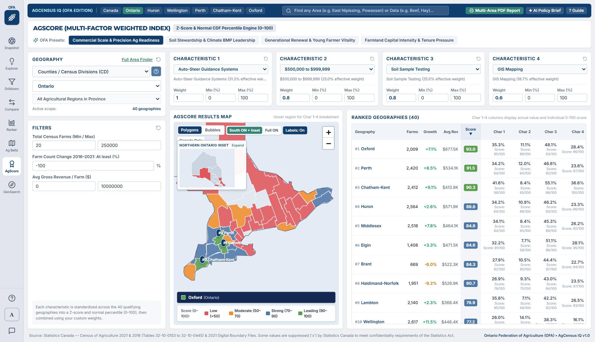

### How to Use AgScore Step by Step

1. **Pick a Ready-Made Policy Preset or Build Your Own:**
   - Start with one of the built-in presets (such as *Agricultural Economic Scale*, *Next-Gen & Innovation Readiness*, or *Intensive Cropping & Soil Stewardship*) or add your own custom combination of up to **6 Census variables**.
2. **Adjust the Importance Weights (`Weight 1x – 5x`) and Direction:**
   - Use the slider next to each variable to give it more or less weight in the overall 0–100 score.
   - Toggle **Higher = Better (`+`)** or **Lower = Better (`-`)** depending on your policy goal.
3. **Inspect the Composite Leaderboard & Map:**
   - Every county is scored on a normalized **0 to 100 scale**, with color-coded contribution bars showing *why* each county ranked high or low, paired with a live heat map on the right.

---

## 9. Tool 8: GeoSearch — Easy Area & Data Finder (No Jargon Required)

**When to use it:** You are new to the tool, you aren't sure whether a place is a "Census Division" or "Census Subdivision", or you just want to click a plain-English question and get an answer immediately.

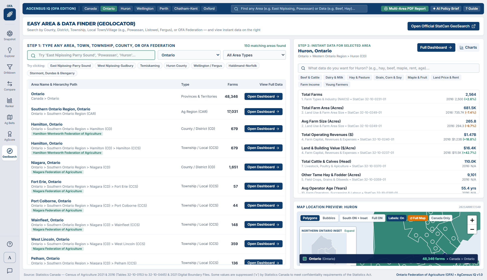

### 3 Easy Ways to Find What You Need in GeoSearch

1. **Tab 1 — "What Question Are You Trying to Answer?" (`Guided Questions`):**
   - Click any plain-language card—such as *"Give me a 1-page summary of farming in my county"*, *"Which counties grow the most Soybeans, Corn, or Wheat?"*, or *"Create a Crop Belt or Heat Map poster for a presentation"*—and the tool will configure the right page and open it for you automatically.
2. **Tab 2 — "Find My Town, County, or Region" (`Browse by Province`):**
   - Type any community name into the big search bar, or click a province and browse clear lists separated into **Agricultural Regions**, **Counties / Districts**, and **Townships / Municipalities**.
   - Every card gives you one-click buttons to open that community in **Snapshot**, **Explorer**, **Ranker**, or **Compare**.
3. **Tab 3 — "Browse All 170+ Farm Topics in Plain English" (`Topic Catalog`):**
   - Search for any word (like *maple*, *solar*, *organic*, *beef*, *tile drainage*, or *direct sales*) to see matching Census variables and launch them directly in Explorer or Ranker.

---

## 10. Global Tool A: Multi-Area PDF Report Builder

**When to use it:** You want to generate a single, clean, multi-area briefing document comparing several counties or townships across a custom checklist of agricultural indicators.

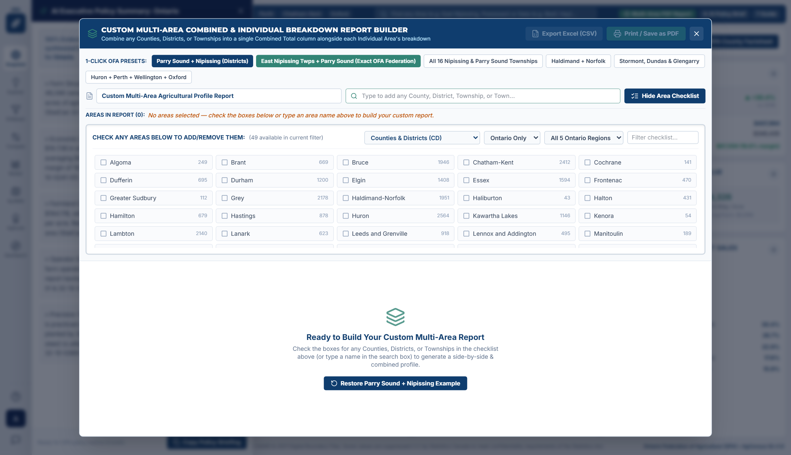

### How to Build a Multi-Area Report

1. Click **`Multi-Area PDF Report`** in the top header bar from any screen.
2. **Select Your Geographies (Left Column):** Search and check as many provinces, counties, or townships as you want to include in your report (plus Quick-Add buttons for *Ontario*, *Canada*, or your *Current Area*).
3. **Select Your Metrics (Right Column):** Check the specific Census categories or individual metrics (e.g., *Total Farms*, *Total Farmland Acres*, *Gross Farm Receipts*, *Commodity Breakdown*) you want printed.
4. Click **`Print / Save Multi-Area PDF`** to open a clean, print-formatted multi-area report that you can save directly as a PDF or send to a printer.

---

## 11. Global Tool B: AI Policy Brief & Speaking Notes Generator

**When to use it:** You need quick, accurate, plain-English talking points, executive summary bullets, and policy takeaways for a briefing note, speech, or media interview.

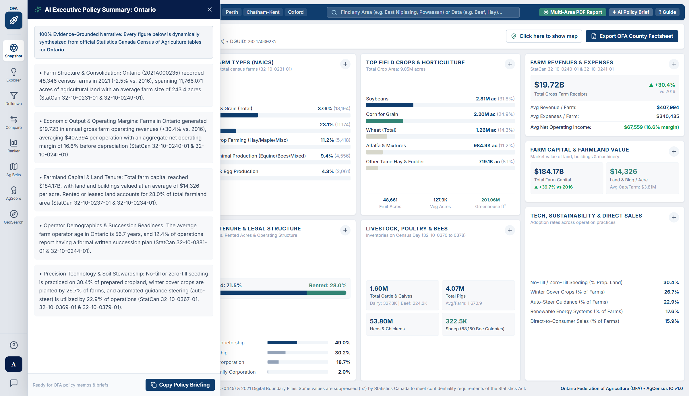

### How to Use the AI Policy Brief Generator

1. Select your target county, township, or province on any page.
2. Click the **`AI Policy Brief`** button in the top-right header bar.
3. The drawer generates an instant, evidence-based briefing structured into:
   - **Executive Summary & Headline Scale** (total farms, acreage, and gross receipts with 2016–2021 growth rates).
   - **Dominant Commodity & Specialization Profile** (how the area compares against the provincial benchmark).
   - **Key Structural Trends & Policy Takeaways** (consolidation, technology adoption, operator demographics, and succession indicators).
4. Click **`Copy Brief to Clipboard`** to paste the speaking notes directly into Microsoft Word, an email, or a briefing memo.

---

## 12. How to Use the Interactive Canada-Only Maps

Every map in **Snapshot**, **Drilldown**, **Ranker**, and **AgScore** has been designed specifically for Canadian agricultural policy so even first-time users can read and navigate it effortlessly:

- **Focused Canada-Only View (Default):** By default, the map clips out foreign countries and oceans (`Canada Only` button active) so 100% of the visual focus stays on Canadian agricultural regions. You can toggle **`Context Base`** at any time if you want to see surrounding geographic context.
- **One-Click Regional Focus Pills:** Use the quick-zoom buttons at the top of the map to frame the exact region you care about:
  - **`All Canada`** — Fits the entire Canadian agricultural belt from British Columbia to Newfoundland.
  - **`West`** — Zooms into British Columbia, Alberta, Saskatchewan, and Manitoba.
  - **`ON / QC`** — Zooms into Ontario and Quebec.
  - **`Atlantic`** — Zooms into New Brunswick, Nova Scotia, PEI, and Newfoundland & Labrador.
  - **`South ON + Inset`** *(appears automatically when viewing Ontario)* — Zooms tightly into Southern Ontario's high-density counties while displaying an interactive **Northern Ontario Districts inset box** in the corner so Northern districts (*Timiskaming*, * Rainy River*, *Thunder Bay*, *Algoma*, *Cochrane*, *Manitoulin*, *Sudbury*, *Nipissing*, *Kenora*, *Parry Sound*) are never tiny or cut off.
- **Plain-English Names for Numbered Prairie & NL Divisions:** Statistics Canada officially names Census Divisions in Manitoba, Saskatchewan, Alberta, and Newfoundland as `"Division No. 1"` through `"Division No. 23"`. AgCensus IQ automatically translates every numbered division to include its major hub city and region—for example, **`Division No. 8 (Red Deer, AB)`** or **`Division No. 11 (Saskatoon, SK)`**—in both the map hover tooltips and ranking tables.
- **On-Map `#1`, `#2`, `#3` Rank Badges:** The top 3 highest-ranking counties on the map are automatically badged with gold `#1`, `#2`, and `#3` pins so your eye goes straight to the leaders.
- **Bottom Live Spotlight Bar:** Hover over any county on the map to see its full name, rank (`#X of N`), exact value, percentage share, and 2016–2021 change in the dark spotlight bar along the bottom of the map.
- **Colorblind-Safe Palette Toggle:** Click **`Accessible`** above any map to switch from the standard green/blue ramp to a high-contrast **Viridis (purple–teal–yellow)** palette designed for colorblind accessibility and black-and-white printing.

---

## 13. Plain-Language Glossary of Common Terms

| Term Used in Census Tables | What It Means in Plain Language |
| :--- | :--- |
| **Census Farm** | Any agricultural operation that produces crops, livestock, poultry, greenhouse products, or maple/honey products intended for sale. |
| **CD (Census Division)** | **County, Regional Municipality, or District** (for example, *Huron County*, *Regional Municipality of Niagara*, or *Timiskaming District*). There are 49 in Ontario and 293 across Canada. |
| **CSD (Census Subdivision)** | **Township, Municipality, Town, or City** inside a county (for example, *Township of Mapleton* inside Wellington County). |
| **CAR (Census Agricultural Region)** | **Broad Provincial Farming Zone** grouping several neighbouring counties together (for example, *Southern Ontario*, *Western Ontario*, *Central Ontario*, *Eastern Ontario*, and *Northern Ontario*). |
| **NAICS (Dominant Farm Type)** | Standard classification that groups each farm by the commodity that accounts for **more than 50% of its estimated gross agricultural revenue** (e.g., *Dairy Cattle & Milk*, *Soybean Farming*, *Beef Cattle Feedlots*, *Greenhouse & Nursery*). |
| **Counts & Share vs. Aggregate Stats** | **Counts & Share** tells you *how many farms* report an activity (and what % of all farms that is). **Aggregate Stats** tells you the *total physical volume*—such as total **Acres**, total **Head of Livestock**, or total **Dollars (\$)**. |
| **16–21 Δ (Change)** | The percentage growth (`+`) or decline (`-`) between the **2016 Census of Agriculture** and the **2021 Census of Agriculture**. |
| **Suppressed (`x` or `0`)** | When only a very small number of farms in a township report a specific crop or financial number, Statistics Canada hides the exact value under the federal *Statistics Act* to protect individual farmer privacy. |
