# AgCensus IQ (OFA Edition) — Plain-Language User Guide

**Prepared for:** Ontario Federation of Agriculture (OFA) Policy Analysts, Member Service Representatives (MSRs), County & Regional Federations, Municipal Leaders & Agricultural Researchers  
**Data Sources:** Statistics Canada — Census of Agriculture (1976–2021, 244 variables across 2,113 geographies), 2021 Digital Boundary Files, OMAFA Commodity Receipts & Field Crop Series (2011–2025), MMAH Financial Information Returns (2021–2024), LIO CLI Soils & Greenbelt, and ISED National Broadband Data

---

## Welcome to AgCensus IQ

**AgCensus IQ** is an interactive agricultural data and rural policy platform built for the **Ontario Federation of Agriculture (OFA)** in alignment with the **2025–26 OFA Brand Identity** and publication-grade data visualization standards. It turns dozens of complex Statistics Canada and provincial tables into declarative headline takeaways, 45-year historical trend charts, 100%-reconciled net-score bridges, empirical regional screening, head-to-head comparisons, county and township leaderboards, publication-ready slide graphics, and downloadable **OFA County & Zone Profile 2.0** Excel workbooks and PDF Fact Sheets.

You do not need any background in statistics, GIS mapping, or Statistics Canada classification codes to use this tool. Every figure is grounded in empirical public data—never synthetic guesses—and every chart translates technical codes into short, plain-English labels while highlighting the primary takeaway in **OFA Crimson** against calm neutral context bars.

---

## Table of Contents

1. [Getting Around the Screen (Header Bar, Left Rail & Global Tools)](#1-getting-around-the-screen-header-bar-left-rail--global-tools)
2. [Tool 1: Ag Snapshot — Instant Community Farm Profile & Operating Net Bridge](#2-tool-1-ag-snapshot--instant-community-farm-profile--operating-net-bridge)
3. [Tool 2: Ag Explorer — Spotlight Bars, Tail Consolidation & 1976–2021 Line Charts](#3-tool-2-ag-explorer--spotlight-bars-tail-consolidation--19762021-line-charts)
4. [Tool 3: Ag Drilldown — Empirical Screening, Exact Joint Bounds & Official Cross-Tabs](#4-tool-3-ag-drilldown--empirical-screening-exact-joint-bounds--official-cross-tabs)
5. [Tool 4: Ag Compare — Side-by-Side Benchmarking & Peer Matcher](#5-tool-4-ag-compare--side-by-side-benchmarking--peer-matcher)
6. [Tool 5: Ag Ranker — Custom Leaderboards (Acres, Livestock Head, Dollars & Farms)](#6-tool-5-ag-ranker--custom-leaderboards-acres-livestock-head-dollars--farms)
7. [Tool 6: Ag Belts & Cluster Maps Studio — Publication & Social Poster Generator](#7-tool-6-ag-belts--cluster-maps-studio--publication--social-poster-generator)
8. [Tool 7: AgScore — Custom Multi-Metric Composite Index (0–100)](#8-tool-7-agscore--custom-multi-metric-composite-index-0100)
9. [Tool 8: GeoSearch — Easy Area, OFA Zone & Commodity Finder](#9-tool-8-geosearch--easy-area-ofa-zone--commodity-finder)
10. [Tool 9: OFA County & Zone Profiles 2.0 (`Profiles 2.0`)](#10-tool-9-ofa-county--zone-profiles-20-profiles-20)
11. [Global Tool A: Multi-Area PDF Report Builder](#11-global-tool-a-multi-area-pdf-report-builder)
12. [Global Tool B: AI Policy Brief & Speaking Notes Generator](#12-global-tool-b-ai-policy-brief--speaking-notes-generator)
13. [How to Use the Interactive Canada-Only Maps](#13-how-to-use-the-interactive-canada-only-maps)
14. [Plain-Language Glossary of Common Terms & Data Symbols](#14-plain-language-glossary-of-common-terms--data-symbols)

---

## 1. Getting Around the Screen (Header Bar, Left Rail & Global Tools)

No matter which tool you are using, the **Champagne Left Navigation Rail** and the **Pickled Bluewood Top Header Bar** stay anchored in place so you never get lost, and your active geography follows you automatically as you switch between tools.

### The Left Navigation Rail (9 Core Tools)
On the far-left edge of the screen (beneath the OFA Crimson squircle emblem), click any of the **9 icons** to switch tools immediately:
1. **Snapshot** — One-screen executive overview of a single province, region, county, or township across 8 analytical cards, led by a declarative takeaway headline.
2. **Explorer** — Deep breakdown of any of the 10 agricultural variable categories, featuring `#1` OFA Crimson spotlight bars, automatic minor-tail consolidation, and 45-year SVG trend line charts (1976–2021).
3. **Drilldown** — Empirical multi-criteria geography screening with exact mathematical joint bounds (Guaranteed Min – Max Possible) plus official Statistics Canada cross-tabulations (Farm Specialization × Income and Farm Specialization × Education).
4. **Compare** — Head-to-head comparison of Geography A (**Pickled Bluewood**) vs. Geography B (**OFA Crimson**) with standardized shared-trait explanations, an automatic `Find Closest Match` peer finder, and slide-ready `1800 × 1125` PNG exports.
5. **Ranker** — Sortable leaderboard and map ranking every county, region, or township across all 244 Census metrics by **Acres**, **Livestock Head**, **Dollars (\$)**, or **Farms**.
6. **Ag Belts** — Publication-ready `1800 × 1125` poster studio for Dominant Crop/Livestock Belts, All-CD Heat Maps, and Cluster Focus maps in Dark Editorial or Light OFA Report themes.
7. **AgScore** — Custom 4-factor weighted index (0–100) with polarity inversion (`↑ High` / `↓ Low`), OFA policy presets, PDF printing, and CSV export.
8. **GeoSearch** — Plain-language finder for any town, township, county, OFA Federation, **OFA Regional Zone (Zone 1–Zone 15)**, or agricultural commodity.
9. **Profiles 2.0** — Complete agri-food & rural policy profiles, operating & commuter net-score bridges, 9-tab Excel workbooks (`.xlsx`), and 2-page PDF Fact Sheets (`.pdf`) for all **49 Ontario Counties & Districts**, **15 OFA Regional Zones**, and **Ontario**.

At the bottom of the left rail are three helper icons: **`?` Guided Walkthrough**, **`A` AI Policy Brief**, and **Empirical Data Sources & Methodology**.

### The Top Header Bar (Always Available)
Across the top Pickled Bluewood header bar (accented by an OFA Crimson bottom rule), you have:
- **Quick-Benchmark Shortcut Pills:** One-click buttons for *Canada*, *Ontario*, *Huron*, *Wellington*, *Perth*, *Chatham-Kent*, and *Oxford* (active benchmark highlighted in OFA Crimson).
- **Global Search Omnibox:** Type any community (*Goderich*, *Listowel*, *Powassan*), county (*Huron*, *Chatham-Kent*), **OFA Zone** (*OFA Zone 7*, *Zone 15*), or farm topic (*dairy*, *tile drainage*, *solar*, *cover crops*) to jump straight to that geography or metric—or combine multiple districts into a multi-area report.
- **`Multi-Area PDF Report` Button (OFA Crimson):** Opens a custom report builder where you can combine multiple counties or townships into one printable briefing package with double-count-safe regional rollups.
- **`AI Policy Brief` Button:** Generates copy-ready executive speaking notes grounded 100% in official Statistics Canada tables (press `Esc` anytime to close).
- **`? Guide` Button:** Launches a step-by-step interactive tour tailored to whichever module is currently open.
- **Streamlit Cloud Direct Download Bar *(when hosted on Streamlit Cloud)*:** A compact expandable bar (`OFA County & Zone Profiles 2.0 — Direct Excel (.xlsx), PDF Fact Sheet & Master ZIP Downloads`) sits right at the top of the browser window for one-click workbook, PDF, and 65-file `.zip` downloads.

---

## 2. Tool 1: Ag Snapshot — Instant Community Farm Profile & Operating Net Bridge

**When to use it:** You have a meeting with a County Federation, municipal council, or MPP/MP and need an accurate, one-screen profile of farming in a specific province, agricultural region, county, or township in seconds.

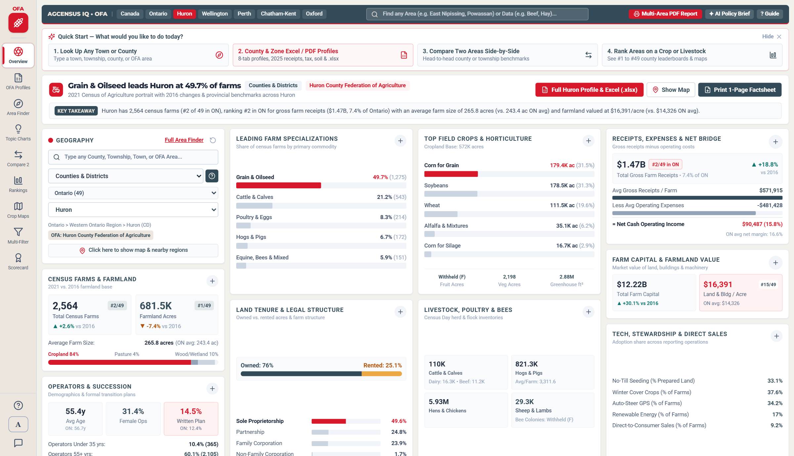

### How to Use Ag Snapshot Step by Step

1. **Read the Top Declarative Headline & Pick Your Area (Top-Left `Geography` Card):**
   - The top banner immediately states the selected geography's leading farm specialization and share of farms.
   - Choose your **Geographic Level** (*Country*, *Provinces*, *Agricultural Regions*, *Counties & Districts*, or *Townships & Municipalities*), filter by province, or type any town, township, county, or OFA Area into the Quick Search box.
2. **Read the 8 Executive Agricultural Cards:**
   - **Card 1 — Census Farms & Farmland:** Total 2021 farms, total farmland acres, average farm size, 2016–2021 % change badges, and a visual Cropland vs. Pasture vs. Woodland/Wetland land-use bar.
   - **Card 2 — Operators & Succession:** Average operator age, % female operators, % under 35 vs. 55+, and % of farms with a formal **Written Succession Plan** (highlighted in OFA Crimson).
   - **Card 3 — Leading Farm Specializations:** Top 5 primary farm sectors in plain English (zero classification codes), spotlighting `#1` in **OFA Crimson** against calm neutral context bars.
   - **Card 4 — Land Tenure & Legal Structure:** Owned (**Pickled Bluewood**) vs. rented/leased (**Tulip Tree**) farmland gauge alongside Sole Proprietorships, Partnerships, and Family/Non-Family Corporations.
   - **Card 5 — Top Field Crops & Horticulture:** Top 5 crops by acreage (`#1` spotlighted in OFA Crimson), plus Fruit acres, Field Vegetable acres, and Greenhouse square footage.
   - **Card 6 — Livestock, Poultry & Bees:** Total Cattle & Calves (Dairy vs. Beef cows), Hogs & Pigs (with average per reporting farm), Hens & Chickens, Sheep, and Honeybee colonies.
   - **Card 7 — Receipts, Expenses & Net Bridge:** Displays Total Gross Farm Receipts alongside a **100%-reconciled visual Net-Score Bridge**: *Avg Gross Receipts / Farm* (**Pickled Bluewood**) minus *Avg Operating Expenses* (**Neutral Slate**) equals *Net Cash Operating Income & Margin %* (**OFA Crimson**) so you never have to subtract expenses in your head.
   - **Card 8 — Farm Capital, Farmland Value & Stewardship Tech:** Total Farm Capital, Land & Building value per acre (\$/acre), and adoption shares for No-Till Seeding, Winter Cover Crops, Auto-Steer GPS, Renewable Energy, and Direct-to-Consumer Sales.
3. **Click `+` on Any Card to Deep-Dive:**
   - Every card has a **`+`** button in its top-right corner that opens that exact topic inside **Ag Explorer**.
4. **Open the Geographic Context & Peer Distance Map (`Click here to show map`):**
   - Highlights your selected boundary on an interactive map alongside the **12 closest peer geographies** ranked by distance (km). Press `Esc` or click `Click here to hide map` to close.

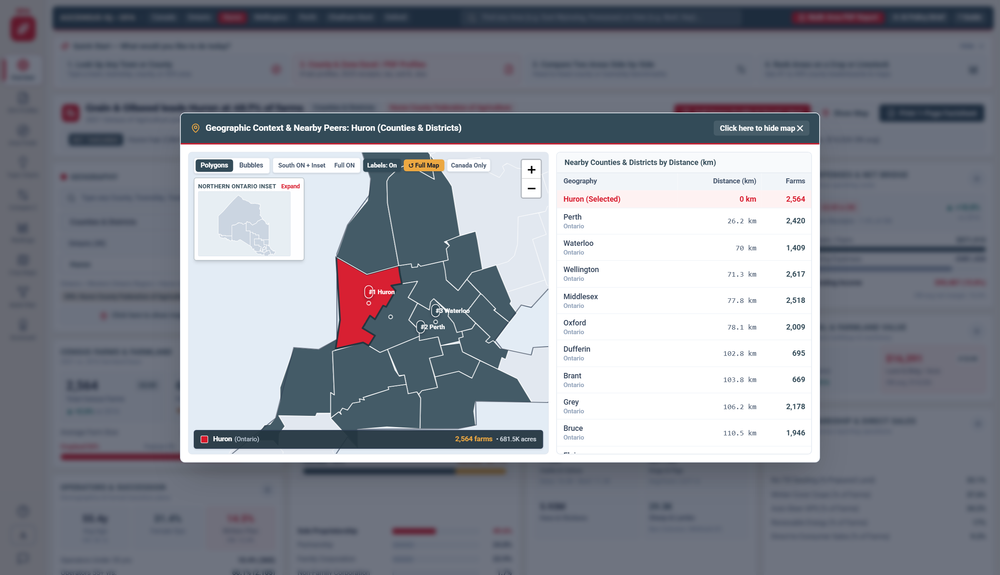

5. **Print a 1-Page Executive Factsheet:**
   - Click **`Export OFA County Factsheet`** in the top header to print or save a clean PDF handout.

---

## 3. Tool 2: Ag Explorer — Spotlight Bars, Tail Consolidation & 1976–2021 Line Charts

**When to use it:** You want to inspect every sub-category within one of the 10 Census topics or trace long-term structural trends across **10 Census waves (1976–2021)**.

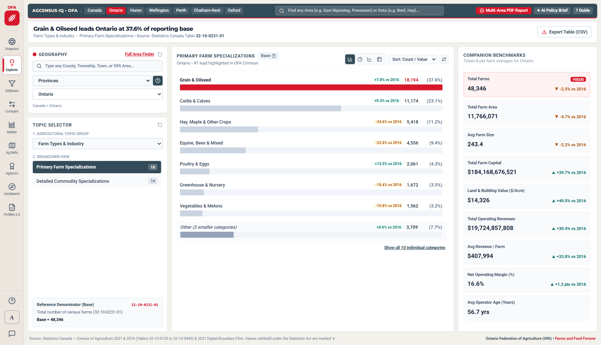

### How to Use Ag Explorer Step by Step

1. **Select Your Geography & Topic Selector (Left Column):**
   - Choose any geography at the top-left, then pick 1 of the 10 plain-English **Agricultural Topic Groups** and select a **Breakdown View** (for example, *Primary Farm Specializations* or *Detailed Commodity Specializations*).
2. **Switch Between the 4 Visualization Views:**
   - **Horizontal Spotlight Bars (Default):** Highlights the `#1` category in **OFA Crimson** while muting peer categories in neutral slate so relative scale is obvious at a 3-second glance. Minor categories under 3% of the base are automatically grouped into a **100%-reconciled `"Other (...)"` bucket** to prevent tiny unreadable slivers—click **`Show all individual categories`** at the bottom-right anytime to expand every row.
   - **Proportional Share / Individual Adoption Gauges:** Displays a clean OFA-toned proportional share bar for mutually exclusive categories. When a category allows farms to report multiple items simultaneously (such as *Precision Technologies* or *Soil Conservation Practices* summing above 100%), Ag Explorer automatically switches to **individual 0–100% adoption gauges** with an explanatory banner so shares are never distorted.
   - **Multi-Census Structural Trajectory (1976–2021):** Renders a zero-clutter **single-scale SVG line chart** above the 10-census reference table. Use the 6 metric pills (*Census Farms*, *Farmland Acres*, *Cropland Acres*, *Avg Farm Size*, *Gross Receipts (\$)*, *Total Capital (\$)*) to view each series on its own clean 4-tick axis (`0` / `\$0` baseline, peak marker, and OFA Crimson 2021 endpoint) without mixing incompatible units.
   - **Data Table & Excel CSV:** Displays exact figures, flags (`x`, `F`, `—`), and denominator units with one-click **`Export Table (CSV)`**.

3. **Verify the Denominator (`Base` Button) & Right-Hand `Companion Benchmarks`:**
   - Click **`Base`** to view the exact Statistics Canada reference denominator (e.g., *Total number of census farms*), and inspect paired totals, averages, and margins in the right-hand **Companion Benchmarks** column.

---

## 4. Tool 3: Ag Drilldown — Empirical Screening, Exact Joint Bounds & Official Cross-Tabs

**When to use it:** You want to screen counties or townships across **multiple farm characteristics at once** without relying on synthetic independence guesses—or inspect Statistics Canada's official linked **Farm Specialization × Household Income** and **Farm Specialization × Operator Education** cross-tabulations.

Ag Drilldown provides **two rigorous empirical modes** toggled at the top of the workspace:

### Mode 1: Multi-Criteria Geography Screening & Exact Joint Bounds (Default)

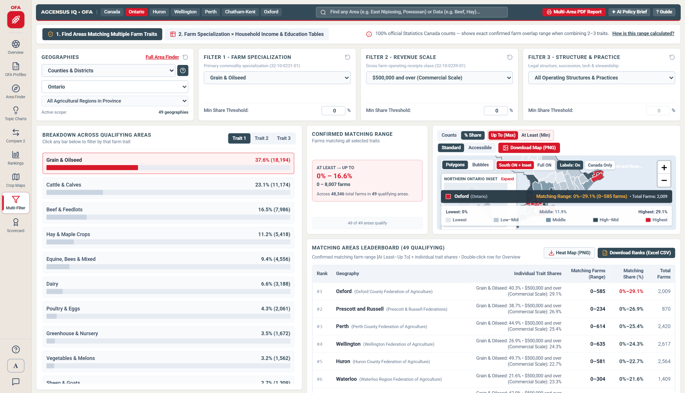

1. **Choose Geographic Scope:** Select *Counties & Districts* or *Townships & Municipalities* and filter to *Ontario*, any province, or *All of Canada*.
2. **Combine Up to 3 Plain-English Empirical Filters & Minimum Share Thresholds (`Min Share Threshold %`):**
   - **Filter 1 — Farm Specialization:** e.g., *Grain & Oilseed*, *Dairy*, *Beef & Feedlots*, *Greenhouse & Nursery*, *Poultry & Eggs*.
   - **Filter 2 — Revenue Scale:** e.g., *\$500,000 and over (Commercial Scale)* or any specific revenue bracket.
   - **Filter 3 — Structure & Practice:** e.g., *Family Corporation*, *Written Succession Plan*, *Auto-Steer GPS*, *Winter Cover Crops*, *Direct Sales*, or *Renewable Energy*.
3. **Read Exact Mathematical Joint Bounds (`Guaranteed Min — Max Possible`):**
   - When a single filter is active, Drilldown shows the **exact published Statistics Canada count and % share**.
   - When 2 or 3 filters are active at the county/township level, Drilldown computes the **exact Fréchet–Hoeffding mathematical range** (`Guaranteed Min — Max Possible` farms and % share) that must hold regardless of correlation, while tracking suppressed (`x` / `F`) areas transparently rather than coercing them to zero.
   - Toggle **`Max Bound`** vs. **`Min Floor`** above the map to shade and rank qualifying areas by either the upper bottleneck or guaranteed minimum overlap.
4. **Export Publication-Grade Slide PNGs & Data:** Click **`Download Map (PNG)`** for an `1800 × 1125` OFA briefing slide complete with a declarative headline, non-overlapping perimeter callouts, and an institutional **Bottom Line** takeaway strip, or click **`Download Ranks (Excel CSV)`**.

### Mode 2: Official StatCan Cross-Tabulations (`32-10-0401-01` & `32-10-0399-01`)

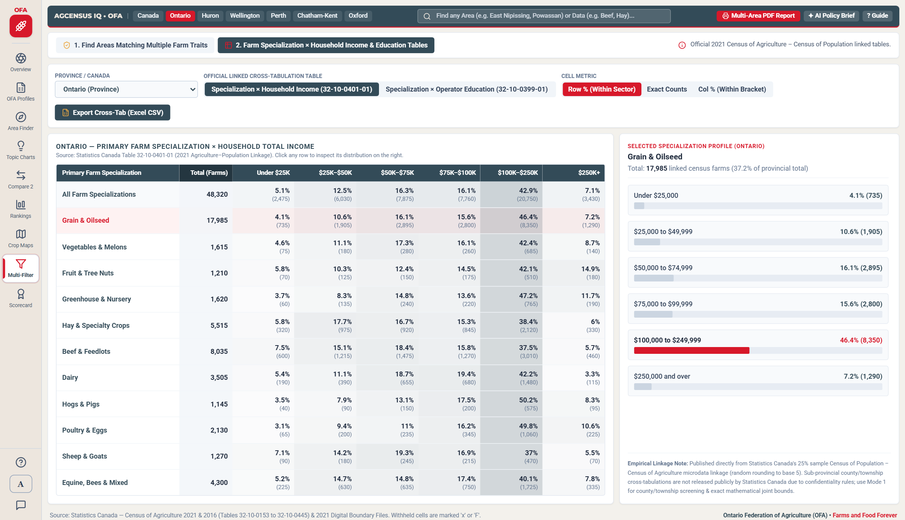

1. Click **`2. Official StatCan Cross-Tabulations (32-10-0401-01 Income & 32-10-0399-01 Education)`** in the top bar.
2. Toggle between **Farm Specialization × Total Household Income (`32-10-0401-01`)** and **Farm Specialization × Operator Educational Attainment (`32-10-0399-01`)** from Statistics Canada's 2021 Agriculture–Population Linkage for Canada or any province.
3. Switch cell display between **`Row %`**, **`Exact Counts`**, and **`Col %`**, click any farm specialization row to spotlight its profile on the right, and click **`Export Cross-Tab (Excel CSV)`**.

---

## 5. Tool 4: Ag Compare — Side-by-Side Benchmarking & Peer Matcher

**When to use it:** You want a head-to-head comparison of any two counties, townships, regions, or provinces—or want to discover which other county in Ontario or Canada aligns most closely with yours across farm structure, commodities, and economics.

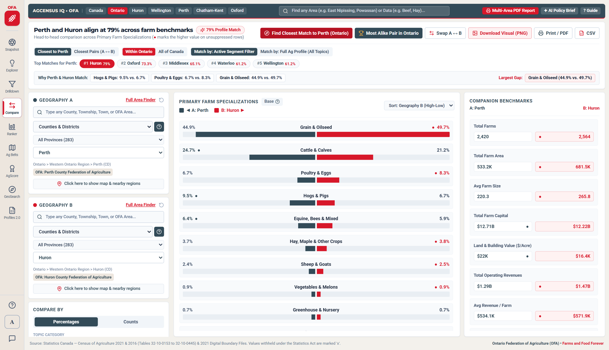

### How to Use Ag Compare Step by Step

1. **Pick Geography A & Geography B — or Auto-Find Peers:**
   - Select Geography A (**Pickled Bluewood `#334B58`**) and Geography B (**OFA Crimson `#D7182A`**) manually, or click **`Find Closest Match`** / **`Most Alike Pair`** at the top. The similarity engine standardizes structural metrics across candidate peers (preserving missing/suppressed `x` and `F` cells rather than treating them as zero) to compute an objective **Profile Match %** and declarative alignment headline.
2. **Read the Shared-Pillar & Largest-Gap Strip:**
   - Immediately highlights the top 3 shared structural traits (`Why They Match`) alongside the single **`Largest Gap`** between the two areas.
3. **Scan Two-Color Butterfly Bars & Winner Dots (`●`):**
   - Toggle between **Percentages** and **Counts**, filter by topic category, and scan the color-matched **Bluewood / Crimson winner dots (`●`)** marking the higher value in each unsuppressed comparison pair.
4. **Export Slide-Ready Deliverables:**
   - Click **`Download Visual (PNG)`** for an `1800 × 1125` OFA comparison slide graphic (featuring shared structural pillars, butterfly bars, top 5 peers, companion benchmarks, and a **Bottom Line** takeaway strip), **`Print / PDF`**, or **`CSV`**.

---

## 6. Tool 5: Ag Ranker — Custom Leaderboards (Acres, Livestock Head, Dollars & Farms)

**When to use it:** You want to rank every county, region, province, or township across any of the 244 Census of Agriculture metrics—by **Acres**, **Livestock Head**, **Dollars (\$)**, **Farms**, or **% Share**.

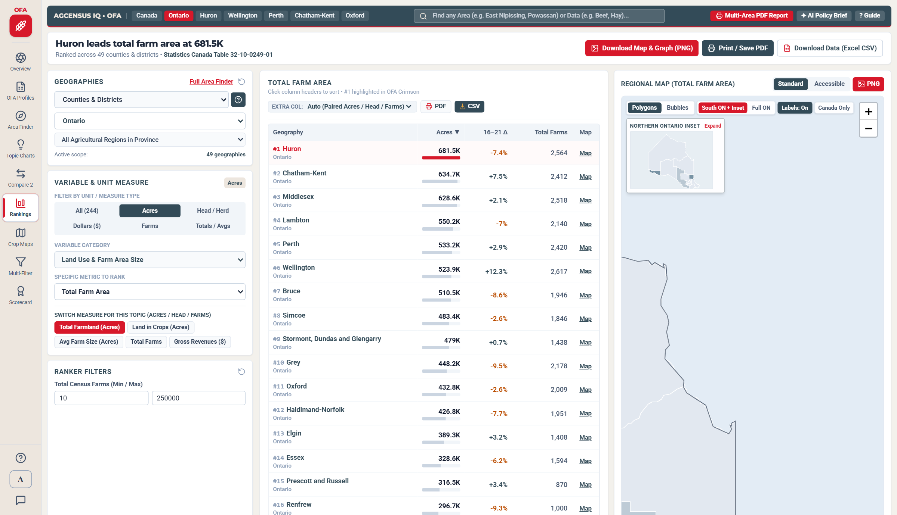

### How to Use Ag Ranker Step by Step

1. **Choose Geographic Scope (`Geographies`):** Rank *Counties & Districts*, *Townships & Municipalities*, *Agricultural Regions*, or *Provinces*, filtered to *Ontario* or *All of Canada*.
2. **Filter by Unit Measure (`Variable & Unit Measure`):**
   - Click one of the **6 Unit Filter buttons** to narrow all 244 Census variables immediately:
     - **`All (244)`** — Every Census variable.
     - **`Acres`** — Total farmland, cropland, field crops, fruit, vegetables, and tillage acres.
     - **`Head / Herd`** — Cattle, dairy cows, beef cows, pigs, sheep, horses, poultry, bees, and average herd sizes.
     - **`Dollars ($)`** — Gross farm receipts, operating expenses, total farm capital, and \$/acre values.
     - **`Farms`** — Number of farms reporting any commodity, revenue class, technology, or stewardship practice.
     - **`Totals / Avgs`** — All physical volumes, dollar totals, and per-farm averages.
3. **One-Click `Switch Measure for This Topic` Pills:**
   - Flip any selected commodity (e.g., *Soybeans*, *Corn*, *Dairy*, *Pigs*) between **Acres / Head**, **Farms Reporting**, and **Per-Farm Average** in one click (active measure highlighted in **OFA Crimson**).
4. **Scan the Spotlight Leaderboard & Customize `Extra Col:`:**
   - The `#1` ranked leader (and any clicked geography) is spotlighted in **OFA Crimson**, while peer inline bars are muted in calm slate so the leader stands out cleanly. Pair your ranked metric with *Auto (Paired Acres / Head / Farms)*, *Total Farmland*, *Land in Crops*, *Avg Farm Size*, *Gross Rev (\$)*, *2016 Prior Value*, or *Total Farms*.
5. **Export Reports:** Click **`Download Map & Graph (PNG)`** (`1800 × 1125` heat map + top-16 leaderboard + **Bottom Line** takeaway strip), **`Print / Save PDF`**, or **`Download Data (Excel CSV)`**.

---

## 7. Tool 6: Ag Belts & Cluster Maps Studio — Publication & Social Poster Generator

**When to use it:** You want to create **editorial-quality `1800 × 1125` maps** for OFA social media posts, policy briefs, presentations, or board decks across Ontario or all 282 agricultural Canadian Counties & Districts.

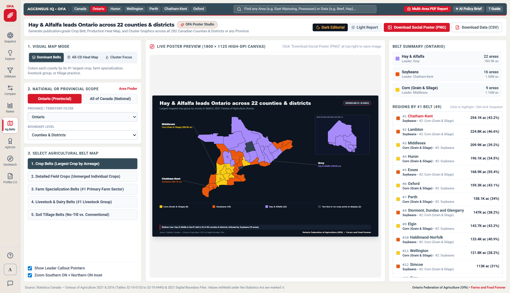

### The 3 Visual Map Modes

1. **`Dominant Belts`:** Colors each county or district by its **#1 largest crop, primary farm specialization, livestock group, or tillage practice**—displaying only active winning belts in provincial legends so zero-count categories never clutter the slide.
2. **`All-CD Heat Map`:** Shades every reporting county or district across 6 continuous tiers so viewers see the entire provincial or national production footprint.
3. **`Cluster Focus`:** Highlights 5-tier quintile concentration clusters for any single metric across all 244 Census variables (including an official *Slate → Pickled Bluewood → OFA Crimson* brand ramp).

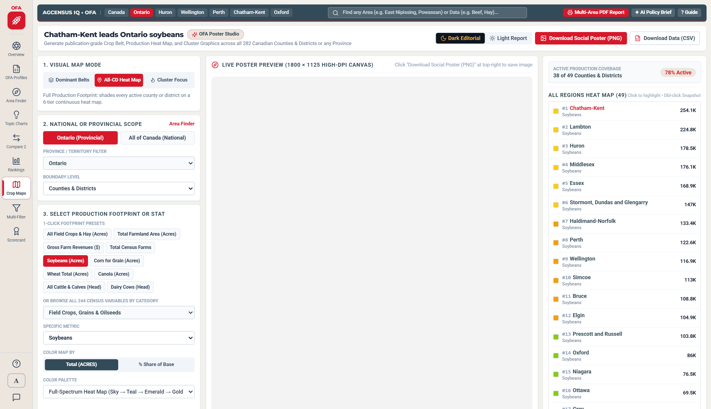

### Customizing & Exporting Your Poster
- Switch between **`Ontario (Provincial)`** (with an automatic **Northern Ontario Districts inset**) and **`All of Canada (National)`**, or pick any individual province.
- Toggle **`Dark Editorial`** vs. **`Light Report`** OFA themes, display dotted non-overlapping leader callouts, and click **`Download Social Poster (PNG)`** (complete with a declarative claim headline and **Bottom Line** takeaway strip) or **`Download Data (CSV)`**.

---

## 8. Tool 7: AgScore — Custom Multi-Metric Composite Index (0–100)

**When to use it:** You want to combine up to **4 Census characteristics** with custom weights into a single standardized **0–100 Composite Index** across counties, regions, or townships.

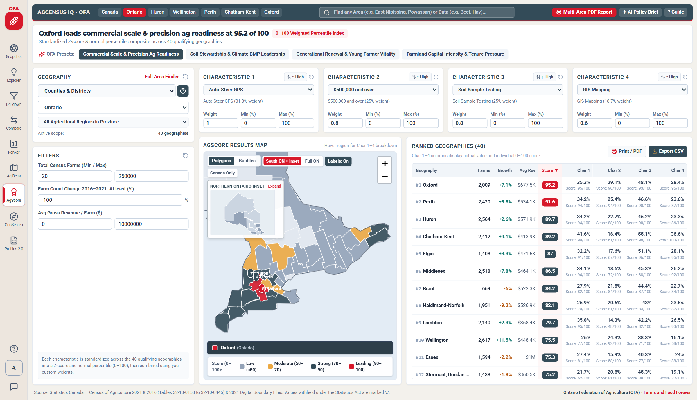

### How to Use AgScore Step by Step

1. **Try a 1-Click OFA Policy Preset or Customize Characteristics 1–4:**
   - Built-in presets include *Commercial Scale & Precision Ag Readiness*, *Soil Stewardship & Climate BMP Leadership*, *Generational Renewal & Young Farmer Vitality*, and *Farmland Capital Intensity & Tenure Pressure*.
2. **Set Weights (0–1), Polarity (`↑ High` vs. `↓ Low`), & Min/Max % Filters:**
   - Adjust each slot's **`Weight`** (0 to 1) and optional **`Min (%)` / `Max (%)`** screening bounds.
   - Click the **`↑ High` / `↓ Low`** polarity toggle at the top-right of any slot card when **lower values should score higher** (for example, younger *Average Operator Age* or lower *Rented Farmland Pressure*).
3. **Inspect OFA Score Bands & Export:**
   - Qualifying geographies are standardized via Z-scores into normal percentiles (0–100) and color-coded using the official OFA Brand hierarchy:
     - **Leading (90–100):** **OFA Crimson (`#D7182A`)**
     - **Strong (70–90):** **Pickled Bluewood (`#334B58`)**
     - **Moderate (50–70):** **Tulip Tree (`#ECA842`)**
     - **Low (<50):** **Neutral Slate (`#94A3B8`)**
   - Click **`Print / PDF`** or **`Export CSV`** in the *Ranked Geographies* header to share or analyze the full multi-factor scorecard.

---

## 9. Tool 8: GeoSearch — Easy Area, OFA Zone & Commodity Finder

**When to use it:** You want to look up any town, township, county, OFA Federation, or **OFA Regional Zone (Zone 1–Zone 15)** in everyday language, check live Census numbers on the spot, or launch a multi-area combined report.

### Key Ways to Search in GeoSearch

1. **Search Communities, Federations, or OFA Zones (Left Panel):**
   - Type any town or village (*Goderich*, *Listowel*, *Powassan*, *Leamington*, *Swift Current*), township (*Mapleton*, *South Huron*), OFA Federation (*East Nipissing-Parry Sound*), or **OFA Regional Zone** (*OFA Zone 7*, *Zone 15*, *OFA Z01*) to see its exact hierarchy path, OFA Federation badge, and farm count.
   - Multi-district OFA federations automatically display a Champagne **Combined Regional Rollup** banner with one-click buttons to print a combined PDF report or compare districts side-by-side.
2. **Instant Agricultural Topic Search (Right Panel):**
   - Search any plain-English keyword (*dairy*, *maple*, *solar*, *no-till*, *land value*, *young farmers*, *honeybees*) across all 244 Census characteristics to view immediate 2021 and 2016 figures—and click any row to jump directly into **Ag Explorer**.

---

## 10. Tool 9: OFA County & Zone Profiles 2.0 (`Profiles 2.0`)

**When to use it:** You need a complete, reconciled agri-food and rural policy profile, a downloadable 9-tab Excel workbook (`.xlsx`), or an executive 2-page PDF Fact Sheet (`.pdf`) for any of Ontario's **49 Counties & Districts**, **15 OFA Regional Zones**, or **Ontario** (65 profiles total).

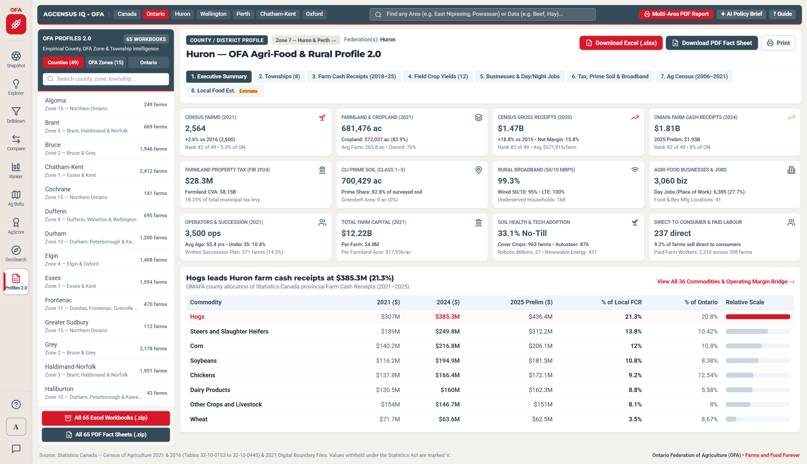

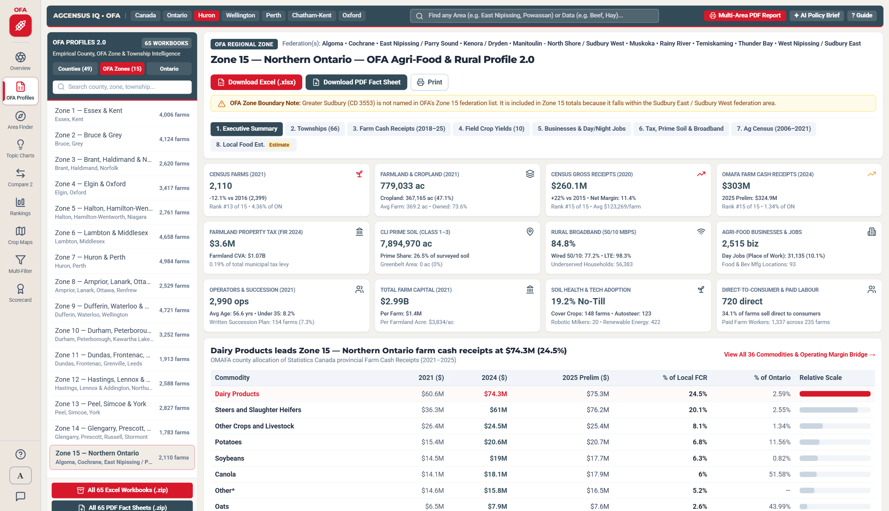

### How to Use OFA County & Zone Profiles 2.0

1. Click **`Profiles 2.0`** on the left navigation rail.
2. In the left Pickled Bluewood selector rail, filter between **`Counties (49)`**, **`OFA Zones (15)`**, and **`Ontario`**, or search by county, federation, or township name. *(Greater Sudbury is reconciled in OFA Zone 15 with an explicit boundary banner, and Stormont, Dundas & Glengarry is split cleanly at the township level between Zone 11 and Zone 14 per the OFA Directory.)*
3. Explore the **8 interactive sub-tabs**:
   - **`1. Executive Summary`** — 12 headline KPI cards plus leading commodities by 2024 OMAFA Farm Cash Receipts (with a declarative headline and `#1` **OFA Crimson** bar spotlight).
   - **`2. Townships`** — Side-by-side comparison of every constituent municipality and township across farms, cropland, gross receipts, net margin, succession plans, 2024 farmland property taxes, 50/10 Mbps broadband, and agri-food businesses.
   - **`3. Farm Cash Receipts (2018–25)`** — Opens with a **100%-reconciled 2020 Census Farm Operating Net-Score Bridge** (*Gross Farm Receipts* minus *Total Operating Expenses* equals *Net Cash Operating Income & Margin %*), followed by OMAFA's 36-commodity annual series (2018–2025 Prelim).
   - **`4. Field Crop Yields`** — Seeded area, harvested area, latest yield, 5-year rolling average yield, and metric-tonne production across 12 major field crops.
   - **`5. Businesses & Day/Night Jobs`** — Plain-English agri-food business location counts (Dec 2016 – Dec 2023) paired with a **100%-reconciled 2021 Agri-Food Workforce Commuter Net-Score Bridge** (*Place-of-Work Daytime Agri-Food Jobs* minus *Resident Agri-Food Workers* equals *Net Daily Commuter Balance*).
   - **`6. Tax, Prime Soil & Broadband`** — MMAH FIR Schedule 26A farmland assessment (CVA) and property taxes (2021–2024), CLI Class 1–3 prime soil acres, Greenbelt acres, and ISED 50/10 Mbps broadband coverage.
   - **`7. Ag Census (2006–2021)`** — Searchable **609-row** 4-census historical table (2006, 2011, 2016, 2021) with zero formula errors and one-click **`Show All 609 Rows`** expansion.
   - **`8. Local Food Est.`** — Clearly badged **Illustrative Estimates** of household food spending and local food demand vs. 2021 production base (keeping acres and head strictly separate).
4. **Download Workbooks, Fact Sheets & Master ZIPs:**
   - Click **`Download Excel (.xlsx)`** (OFA Crimson button), **`Download PDF Fact Sheet`** (Pickled Bluewood button), **`All 65 Excel Workbooks (.zip)`**, or **`All 65 PDF Fact Sheets (.zip)`**.

---

## 11. Global Tool A: Multi-Area PDF Report Builder

**When to use it:** You want to combine multiple counties, townships, or regions into a single formatted briefing report with automatic double-count-safe regional rollups.

1. Click **`Multi-Area PDF Report`** in the top header bar (or launch directly from GeoSearch / Omnibox).
2. Add or remove geographies (or click one of the **1-Click OFA Presets**)—nested child townships inside an already-selected parent county are automatically flagged so **COMBINED TOTAL** never double-counts farms or acres, and intensive metrics (like average age or net operating margin %) are aggregated using true denominator-weighted formulas.
3. Click **`Print / Save as PDF`** or **`Export Excel (CSV)`**.

---

## 12. Global Tool B: AI Policy Brief & Speaking Notes Generator

**When to use it:** You need instant, citation-backed executive bullets for a briefing memo, municipal deputation, board update, or media interview.

1. Select any geography and click **`AI Policy Brief`** in the top header (or **`A`** on the bottom-left rail).
2. Review the 5 evidence-grounded paragraphs covering Farm Structure, Economic Output & Margins, Farmland Capital & Tenure, Operator Demographics & Succession, and Precision Tech & Soil Stewardship—each citing its exact Statistics Canada table number.
3. Click **`Copy Policy Briefing`** to paste directly into Word, Outlook, or PowerPoint.

---

## 13. How to Use the Interactive Canada-Only Maps

Every interactive map in **Snapshot**, **Drilldown**, **Ranker**, **AgScore**, and **GeoSearch** includes:
- **`Canada Only` Vector Canvas (Default) vs. `Streets: On`:** Focuses 100% of screen space on Canadian agricultural boundaries, with optional reference street/city tiles.
- **One-Click Regional Focus Pills:** Jump to **`All Canada`**, **`West / Prairies`**, **`ON / QC`**, **`Atlantic`**, or **`South ON + Inset`** (which pairs Southern Ontario with an auto-flowing interactive **Northern Ontario Inset** that never overlaps wrapped map controls).
- **Plain-English Names for Numbered Prairie & NL Divisions:** Automatically enriches Division No. 1–Division No. 23 with hub cities (e.g., *Division No. 8 — Red Deer / Lacombe / Ponoka*).
- **OFA Rank Pins (`#1` in OFA Crimson, `#2–#3` in Pickled Bluewood), Live Bottom Spotlight Bar, & `Standard | Accessible` Palette Toggle.**

---

## 14. Plain-Language Glossary of Common Terms & Data Symbols

| Term or Symbol | What It Means in Plain Language |
| :--- | :--- |
| **Census Farm** | Any agricultural operation producing crops, livestock, poultry, greenhouse/nursery products, maple syrup, or honey intended for sale. |
| **Counties & Districts (CD)** | County, Regional Municipality, Single-Tier City, or Northern District (49 in Ontario; 282 agricultural divisions across Canada). |
| **Townships & Municipalities (CCS)** | Local lower-tier Township or Consolidated Subdivision inside a county (414 in Ontario; 1,748 across Canada). |
| **Agricultural Regions (CAR)** | Sub-provincial farming region grouping neighbouring counties (5 in Ontario: *Southern, Western, Central, Eastern,* and *Northern Ontario*; 72 across Canada). |
| **OFA Regional Zones (Zone 1–Zone 15)** | The 15 official Ontario Federation of Agriculture governance zones grouping Ontario's county and regional federations (searchable directly and profiled in **Tool 9: Profiles 2.0**). |
| **Primary Farm Specialization (NAICS)** | Classifies each farm by the commodity group generating more than 50% of its estimated gross agricultural receipts (displayed in plain English on all charts, such as *Grain & Oilseed*, *Dairy*, or *Beef & Feedlots*). |
| **Net-Score Bridge** | Visual bar summary reconciling offsetting inflows and outflows (*Gross Receipts − Operating Expenses = Net Cash Income*; *Place-of-Work Daytime Jobs − Resident Workers = Net Commuter Balance*) so viewers never have to do mental subtraction. |
| **Exact Joint Bounds (`Guaranteed Min – Max Possible`)** | In **Ag Drilldown**, the mathematically guaranteed minimum and maximum possible number (and %) of farms meeting 2 or 3 criteria simultaneously based on published Statistics Canada marginals—avoiding synthetic multiplication assumptions. |
| **`x` — `x (Suppressed)`** | **Confidentiality Suppression:** Withheld by Statistics Canada under the federal *Statistics Act* when too few farms report in a local area to protect individual farm privacy. Never treated as zero. |
| **`F` — `F (Unreliable)`** | **Quality Suppression:** Marked `'F'` (*"too unreliable to be published"*) under Statistics Canada's 2021 Census quality rules when sampling or imputation dispersion is too high for reliable release. |
| **`—` / `N/A` (Not Applicable)** | **Zero Reporting Denominator:** Shown on per-farm averages or ratios when 0 farms in a township report that specific commodity, distinguishing true absence from `'x'` suppression. |
| **`16–21 Δ` (Change)** | Percentage growth (`+`) or decline (`-`)—or percentage-point shift (`pts`) for rate metrics—between the 2016 and 2021 Censuses of Agriculture. |
