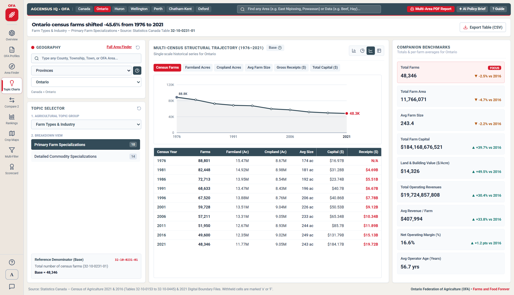
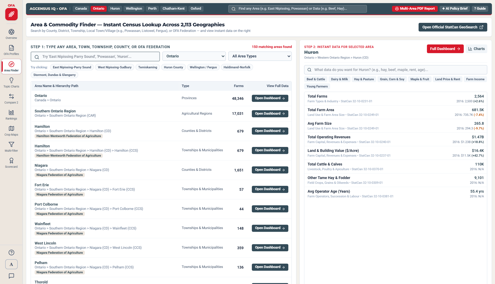
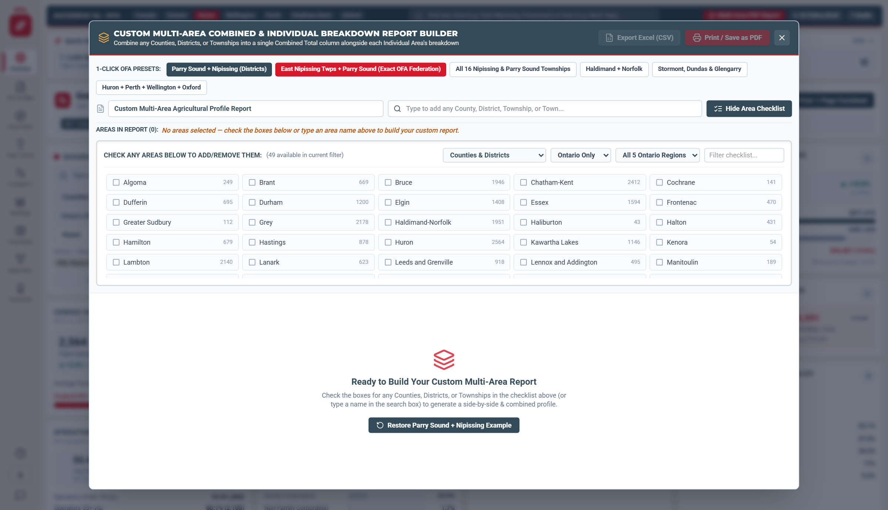
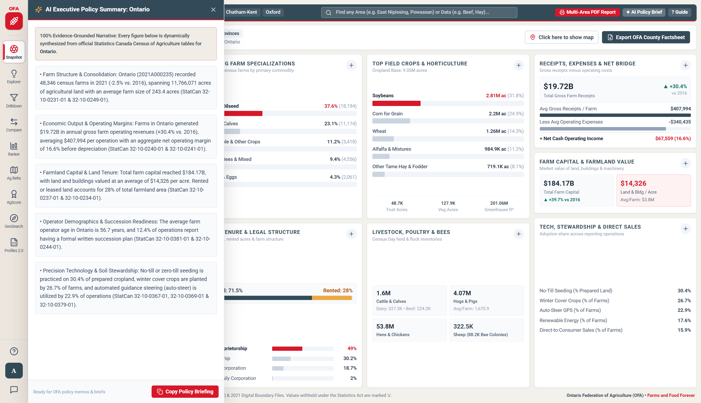

# AgCensus IQ (OFA Edition) — Plain-Language User Guide

**Prepared for:** Ontario Federation of Agriculture (OFA) Policy Analysts, Member Service Representatives (MSRs), County & Regional Federations, Municipal Leaders & Agricultural Researchers  
**Data Sources:** Statistics Canada — Census of Agriculture (1976–2021, 244 variables across 2,113 geographies), 2021 Digital Boundary Files, OMAFA Commodity Receipts & Field Crop Series (2011–2025), MMAH Financial Information Returns (2021–2024), LIO CLI Soils & Greenbelt, and ISED National Broadband Data

---

## Welcome to AgCensus IQ

**AgCensus IQ** is an interactive agricultural data and rural policy platform built for the **Ontario Federation of Agriculture (OFA)** in alignment with the **2025–26 OFA Brand Identity** and publication-grade data visualization standards. It turns dozens of complex Statistics Canada and provincial tables into declarative headline takeaways, 45-year historical trend charts, 100%-reconciled net-score bridges, empirical regional screening, head-to-head comparisons, county and township leaderboards, publication-ready slide graphics, and downloadable **OFA County & Zone Profile 2.0** Excel workbooks and PDF Fact Sheets.

You do not need any background in statistics, GIS mapping, or Statistics Canada classification codes to use this tool. Every figure is grounded in empirical public data—never synthetic guesses—and every chart translates technical codes into short, plain-English labels while highlighting the primary takeaway in **OFA Crimson** against calm neutral context bars.

---

## Table of Contents

1. [Getting Around the Screen (Quick-Start Launcher, Left Rail & Smart Omnibox)](#1-getting-around-the-screen-quick-start-launcher-left-rail--smart-omnibox)
2. [Tool 1: Overview — Community Farm Summary, Provincial Ranks & Operating Net Bridge](#2-tool-1-overview--community-farm-summary-provincial-ranks--operating-net-bridge)
3. [Tool 2: Topic Charts — Spotlight Bars, Tail Consolidation & 1976–2021 Line Charts](#3-tool-2-topic-charts--spotlight-bars-tail-consolidation--19762021-line-charts)
4. [Tool 3: Multi-Filter — Multi-Trait Farm Screening & Income/Education Tables](#4-tool-3-multi-filter--multi-trait-farm-screening--incomeeducation-tables)
5. [Tool 4: Compare 2 — Side-by-Side Benchmarking & Peer Matcher](#5-tool-4-compare-2--side-by-side-benchmarking--peer-matcher)
6. [Tool 5: Rankings — Custom Leaderboards (Acres, Livestock Head, Dollars & Farms)](#6-tool-5-rankings--custom-leaderboards-acres-livestock-head-dollars--farms)
7. [Tool 6: Crop Maps — Publication & Social Poster Generator](#7-tool-6-crop-maps--publication--social-poster-generator)
8. [Tool 7: Scorecard — Custom 0–100 Multi-Trait Peer Scorecard](#8-tool-7-scorecard--custom-0100-multi-trait-peer-scorecard)
9. [Tool 8: Area Finder — Easy Town, Township, OFA Zone & Commodity Lookup](#9-tool-8-area-finder--easy-town-township-ofa-zone--commodity-lookup)
10. [Tool 9: OFA Profiles — 8-Tab County & OFA Zone Intelligence + Excel/PDF Downloads](#10-tool-9-ofa-profiles--8-tab-county--ofa-zone-intelligence--excelpdf-downloads)
11. [Global Tool A: Multi-Area PDF Report Builder](#11-global-tool-a-multi-area-pdf-report-builder)
12. [Global Tool B: AI Policy Brief & Speaking Notes Generator](#12-global-tool-b-ai-policy-brief--speaking-notes-generator)
13. [How to Use the Interactive Canada-Only Maps](#13-how-to-use-the-interactive-canada-only-maps)
14. [Plain-Language Glossary of Common Terms & Data Symbols](#14-plain-language-glossary-of-common-terms--data-symbols)

---

## 1. Getting Around the Screen (Quick-Start Launcher, Left Rail & Smart Omnibox)

No matter which tool you are using, the **Champagne Left Navigation Rail** (or **Sticky Bottom Bar** on mobile phones) and the **Pickled Bluewood Top Header Bar** stay anchored in place so you never get lost, and your active geography follows you automatically across screens.

### The Plain-English Navigation Rail (9 Core Tools)
On the left edge of the screen (beneath the OFA Crimson squircle emblem), click any of the **9 plain-English icons** to switch tools immediately:
1. **Overview** — At-a-glance summary of a single province, region, county, or township across 8 cards, complete with a **Quick-Start Task Bar**, a 1-sentence **Key Takeaway**, **`#Rank of 49 in ON`** badges, **Ontario average (`ON avg`)** comparisons, and a 1-click button to open **OFA Profiles & Excel (`.xlsx`)**.
2. **OFA Profiles** — Complete 8-tab agri-food & rural profiles, operating & commuter net-score bridges, 9-tab Excel workbooks (`.xlsx`), and 2-page PDF Fact Sheets (`.pdf`) for all **49 Ontario Counties & Districts**, **15 OFA Regional Zones**, and **Ontario**.
3. **Area Finder** — Everyday-language finder for any town, village, township, county, OFA Federation, **OFA Regional Zone (Zone 1–Zone 15)**, or agricultural commodity.
4. **Topic Charts** — Detailed breakdown of any of the 10 agricultural topic categories, featuring `#1` OFA Crimson spotlight bars, automatic minor-tail consolidation, and 45-year SVG trend line charts (1976–2021).
5. **Compare 2** — Head-to-head comparison of Area A (**Pickled Bluewood**) vs. Area B (**OFA Crimson**) with an always-visible **Compare Topic** bar right above the chart, an automatic `Find Closest Match` peer finder, and slide-ready `1800 × 1125` PNG exports.
6. **Rankings** — Sortable leaderboard and map ranking every county, region, or township across all 244 Census metrics by **Acres**, **Livestock Head**, **Dollars (\$)**, or **Farms**.
7. **Crop Maps** — Publication-ready `1800 × 1125` poster studio for Dominant Crop/Livestock Belts, All-CD Heat Maps, and Cluster Focus maps in Dark Editorial or Light OFA Report themes.
8. **Multi-Filter** — Plain-language multi-trait screening showing the **Confirmed Matching Range (`At Least → Up To`)** of farms matching 2–3 traits simultaneously, plus official Statistics Canada **Farm Specialization × Household Income** and **Education** tables.
9. **Scorecard** — Custom 0–100 peer scorecard combining up to 4 farm traits with simple **`Off | Low | Med | High`** priority buttons, real trait column headers, and 4 ready-made OFA scorecards.

At the bottom of the left rail are three helper icons: **`?` Guided Walkthrough**, **`A` AI Policy Brief**, and **Empirical Data Sources & Methodology**.

### The Top Header Bar & Smart Omnibox (Always Available)
Across the top Pickled Bluewood header bar (accented by an OFA Crimson bottom rule), you have:
- **Quick-Benchmark Shortcut Pills:** One-click buttons for *Canada*, *Ontario*, *Huron*, *Wellington*, *Perth*, *Chatham-Kent*, and *Oxford* (active benchmark highlighted in OFA Crimson).
- **Smart Global Search Omnibox:** Type any community (*Goderich*, *Listowel*, *Powassan*), county (*Huron*, *Chatham-Kent*), **OFA Zone** (*OFA Zone 7*, *Zone 15*), or farm question (*dairy*, *cash rent*, *farmland price*, *tile drainage*, *broadband*, *property tax*, *crop yields*) to jump straight to that area, chart, or **OFA Profiles** tab in 1 click.
- **`Multi-Area PDF Report` Button (OFA Crimson):** Opens a custom report builder where you can combine multiple counties or townships into one printable briefing package with double-count-safe regional rollups.
- **`AI Policy Brief` Button:** Generates copy-ready executive speaking notes grounded 100% in official Statistics Canada tables (press `Esc` anytime to close).
- **`? Guide` Button:** Launches a warm, jargon-free 3-step tour tailored to whichever screen is currently open.
- **Streamlit Cloud Direct Download Bar *(when hosted on Streamlit Cloud)*:** A compact expandable bar (`OFA County & Zone Profiles 2.0 — Direct Excel (.xlsx), PDF Fact Sheet & Master ZIP Downloads`) sits right at the top of the browser window for one-click workbook, PDF, and 65-file `.zip` downloads.

---

## 2. Tool 1: Overview — Community Farm Summary, Provincial Ranks & Operating Net Bridge

**When to use it:** You have a meeting with a County Federation, municipal council, or MPP/MP—or you are a farmer or resident curious about local agriculture—and want an instant, self-explaining summary of any province, county, or township.

### How to Use Overview Step by Step

1. **Use the `Quick Start` Bar or Ontario-First `Geography` Picker:**
   - First-time visitors can click any of the 4 **Quick Start** task cards at the top (*Look Up Any Town or County*, *County & Zone Excel / PDF Profiles*, *Compare Two Areas Side-by-Side*, or *Rank Areas on a Crop or Livestock*)—or click `Hide ✕` anytime for extra room.
   - In the top-left **Geography** card, Ontario's **49 Counties & Districts** (and **414 Townships**) are shown first by default (`All of Canada` is 1 click away in the province dropdown).
2. **Read the `Key Takeaway`, `#Rank` Badges & `ON avg` Benchmarks:**
   - Directly beneath the headline, a 1-sentence **Key Takeaway** summarizes your area's farm count, provincial rank, gross farm receipts, average farm size, and per-acre farmland value relative to the provincial average.
   - Cards display automatic **`#Rank/49`** pills and **`ON avg`** reference anchors so every number has instant everyday context.
   - Click the red **`Full [County] Profile & Excel (.xlsx)`** button in the header to jump straight into **OFA Profiles** for 2025 Farm Cash Receipts, Townships, Tax, Soil, Broadband, and `.xlsx` downloads.
3. **Helpful Recovery on Smaller Townships (`Withheld (x)` / `Withheld (F)`):**
   - When Statistics Canada withholds financial or livestock figures in a smaller township to protect farmer privacy, Overview displays calm `Withheld (x)` / `Withheld (F)` badges (never phantom chart bars) and shows a **1-click Parent-County Banner** (*`View Complete Data for [Parent County] →`*).
4. **Open the Peer Distance Map (`Show Map`) & Print a 1-Page Handout (`Print 1-Page Factsheet`):**
   - Click **`Show Map`** to view your boundary alongside the 12 closest peer areas by distance (km), or click **`Print 1-Page Factsheet`** for a clean handout.

---

## 3. Tool 2: Topic Charts — Spotlight Bars, Tail Consolidation & 1976–2021 Line Charts

**When to use it:** You want to inspect every sub-category within one of the 10 Census topics or trace long-term structural trends across **10 Census waves (1976–2021)**.

### How to Use Ag Explorer Step by Step

1. **Select Your Geography & Topic Selector (Left Column):**
   - Choose any geography at the top-left, then pick 1 of the 10 plain-English **Agricultural Topic Groups** and select a **Breakdown View** (for example, *Primary Farm Specializations* or *Detailed Commodity Specializations*).
2. **Switch Between the 4 Visualization Views:**
   - **Horizontal Spotlight Bars (Default):** Highlights the `#1` category in **OFA Crimson** while muting peer categories in neutral slate so relative scale is obvious at a 3-second glance. Minor categories under 3% of the base are automatically grouped into a **100%-reconciled `"Other (...)"` bucket** to prevent tiny unreadable slivers—click **`Show all individual categories`** at the bottom-right anytime to expand every row.
   - **Proportional Share / Individual Adoption Gauges:** Displays a clean OFA-toned proportional share bar for mutually exclusive categories. When a category allows farms to report multiple items simultaneously (such as *Precision Technologies* or *Soil Conservation Practices* summing above 100%), Ag Explorer automatically switches to **individual 0–100% adoption gauges** with an explanatory banner so shares are never distorted.
   - **Multi-Census Structural Trajectory (1976–2021):** Renders a zero-clutter **single-scale SVG line chart** above the 10-census reference table. Use the 6 metric pills (*Census Farms*, *Farmland Acres*, *Cropland Acres*, *Avg Farm Size*, *Gross Receipts (\$)*, *Total Capital (\$)*) to view each series on its own clean 4-tick axis (`0` / `\$0` baseline, peak marker, and OFA Crimson 2021 endpoint) without mixing incompatible units.
   - **Data Table & Excel CSV:** Displays exact figures, flags (`x`, `F`, `—`), and denominator units with one-click **`Export Table (CSV)`**.

3. **Verify the Denominator (`Base` Button) & Right-Hand `Companion Benchmarks`:**
   - Click **`Base`** to view the exact Statistics Canada reference denominator (e.g., *Total number of census farms*), and inspect paired totals, averages, and margins in the right-hand **Companion Benchmarks** column.

---

## 4. Tool 3: Multi-Filter — Multi-Trait Farm Screening & Income/Education Tables

**When to use it:** You want to find counties or townships matching **2 or 3 farm traits at once** without relying on synthetic guesswork—or inspect Statistics Canada's official linked **Farm Specialization × Household Income** and **Farm Specialization × Operator Education** tables.

`Multi-Filter` provides **two plain-language empirical modes** toggled at the top of the workspace:

### Mode 1: Find Areas Matching Multiple Farm Traits (Default)

1. **Choose Geographic Scope:** Select *Counties & Districts* or *Townships & Municipalities* and filter to *Ontario*, any province, or *All of Canada*.
2. **Combine Up to 3 Plain-English Farm Traits & Optional Minimum Share Thresholds (`Min Share Threshold %`):**
   - **Filter 1 — Farm Specialization:** e.g., *Grain & Oilseed*, *Dairy*, *Beef & Feedlots*, *Greenhouse & Nursery*, *Poultry & Eggs*.
   - **Filter 2 — Revenue Scale:** e.g., *\$500,000 and over (Commercial Scale)* or any specific revenue bracket.
   - **Filter 3 — Structure & Practice:** e.g., *Family Corporation*, *Written Succession Plan*, *Auto-Steer GPS*, *Winter Cover Crops*, *Direct Sales*, or *Renewable Energy*.
3. **Read the `Confirmed Matching Range (At Least → Up To)`:**
   - When 1 trait is selected, `Multi-Filter` shows the **exact published Statistics Canada count and % share**.
   - When 2 or 3 traits are selected, `Multi-Filter` displays the **exact Confirmed Matching Range** (`At Least → Up To` farms and % share, computed via exact Fréchet–Hoeffding mathematical bounds—click **`How is this range calculated?`** anytime for a 2-sentence plain-English explanation) alongside readable individual trait shares in every table row.
   - Toggle **`Up To (Max)`** vs. **`At Least (Min)`** above the map to sort and shade areas, and click **`Download Map (PNG)`** or **`Download Ranks (Excel CSV)`**.

### Mode 2: Farm Specialization × Household Income & Education Tables (`32-10-0401-01` & `32-10-0399-01`)

1. Click **`2. Farm Specialization × Household Income & Education Tables`** in the top bar.
2. Toggle between **Specialization × Household Income (`32-10-0401-01`)** and **Specialization × Operator Education (`32-10-0399-01`)** for Canada or any province, switch between **`Row %`**, **`Exact Counts`**, and **`Col %`**, and click **`Export Cross-Tab (Excel CSV)`**.

---

## 5. Tool 4: Compare 2 — Side-by-Side Benchmarking & Peer Matcher

**When to use it:** You want a head-to-head comparison of any two counties, townships, regions, or provinces—or want to discover which other county in Ontario or Canada aligns most closely with yours.

### How to Use Compare 2 Step by Step

1. **Pick Geography A & Geography B — or Auto-Find Peers:**
   - Select Geography A (**Pickled Bluewood `#334B58`**) and Geography B (**OFA Crimson `#D7182A`**) on the left, or click **`Find Closest Match`** / **`Most Alike Pair`** at the top to compute an objective **Profile Match %** alongside `Why They Match` and `Largest Gap` callouts.
2. **Switch Comparison Topics Right Above the Chart (`Compare Topic` Bar):**
   - Use the prominent **`Compare Topic`** bar right above the butterfly bars to flip between *Farm Types*, *Field Crops*, *Livestock*, *Farm Size*, *Revenues*, or *Demographics*—and toggle **`% Share`** vs. **`Counts`**.
3. **Scan Two-Color Butterfly Bars, Winner Dots (`●`) & Export Deliverables:**
   - Color-matched **Bluewood / Crimson winner dots (`●`)** mark the higher value on unsuppressed rows. Click **`Download Visual (PNG)`** (`1800 × 1125` OFA slide), **`Print / PDF`**, or **`CSV`**.

---

## 6. Tool 5: Rankings — Custom Leaderboards (Acres, Livestock Head, Dollars & Farms)

**When to use it:** You want to rank every county, region, province, or township across any of the 244 Census of Agriculture metrics—by **Acres**, **Livestock Head**, **Dollars (\$)**, **Farms**, or **% Share**.

### How to Use Ag Ranker Step by Step

1. **Choose Geographic Scope (`Geographies`):** Rank *Counties & Districts*, *Townships & Municipalities*, *Agricultural Regions*, or *Provinces*, filtered to *Ontario* or *All of Canada*.
2. **Filter by Unit Measure (`Variable & Unit Measure`):**
   - Click one of the **6 Unit Filter buttons** to narrow all 244 Census variables immediately:
     - **`All (244)`** — Every Census variable.
     - **`Acres`** — Total farmland, cropland, field crops, fruit, vegetables, and tillage acres.
     - **`Head / Herd`** — Cattle, dairy cows, beef cows, pigs, sheep, horses, poultry, bees, and average herd sizes.
     - **`Dollars ($)`** — Gross farm receipts, operating expenses, total farm capital, and \$/acre values.
     - **`Farms`** — Number of farms reporting any commodity, revenue class, technology, or stewardship practice.
     - **`Totals / Avgs`** — All physical volumes, dollar totals, and per-farm averages.
3. **One-Click `Switch Measure for This Topic` Pills:**
   - Flip any selected commodity (e.g., *Soybeans*, *Corn*, *Dairy*, *Pigs*) between **Acres / Head**, **Farms Reporting**, and **Per-Farm Average** in one click (active measure highlighted in **OFA Crimson**).
4. **Scan the Spotlight Leaderboard & Customize `Extra Col:`:**
   - The `#1` ranked leader (and any clicked geography) is spotlighted in **OFA Crimson**, while peer inline bars are muted in calm slate so the leader stands out cleanly. Pair your ranked metric with *Auto (Paired Acres / Head / Farms)*, *Total Farmland*, *Land in Crops*, *Avg Farm Size*, *Gross Rev (\$)*, *2016 Prior Value*, or *Total Farms*.
5. **Export Reports:** Click **`Download Map & Graph (PNG)`** (`1800 × 1125` heat map + top-16 leaderboard + **Bottom Line** takeaway strip), **`Print / Save PDF`**, or **`Download Data (Excel CSV)`**.

---

## 7. Tool 6: Crop Maps — Publication & Social Poster Generator

**When to use it:** You want to create **editorial-quality `1800 × 1125` maps** for OFA social media posts, policy briefs, presentations, or board decks across Ontario or all 282 agricultural Canadian Counties & Districts.

### The 3 Visual Map Modes

1. **`Dominant Belts`:** Colors each county or district by its **#1 largest crop, primary farm specialization, livestock group, or tillage practice**—displaying only active winning belts in provincial legends so zero-count categories never clutter the slide.
2. **`All-CD Heat Map`:** Shades every reporting county or district across 6 continuous tiers so viewers see the entire provincial or national production footprint.
3. **`Cluster Focus`:** Highlights 5-tier quintile concentration clusters for any single metric across all 244 Census variables (including an official *Slate → Pickled Bluewood → OFA Crimson* brand ramp).

### Customizing & Exporting Your Poster
- Switch between **`Ontario (Provincial)`** (with an automatic **Northern Ontario Districts inset**) and **`All of Canada (National)`**, or pick any individual province.
- Toggle **`Dark Editorial`** vs. **`Light Report`** OFA themes, display dotted non-overlapping leader callouts, and click **`Download Social Poster (PNG)`** (complete with a declarative claim headline and **Bottom Line** takeaway strip) or **`Download Data (CSV)`**.

---

## 8. Tool 7: Scorecard — Custom 0–100 Multi-Trait Peer Scorecard

**When to use it:** You want to combine up to **4 farm traits** into a single easy-to-read **0–100 Peer Score** across counties, regions, or townships.

### How to Use Scorecard Step by Step

1. **Click a `Ready-Made Scorecard` or Pick Up to 4 Traits:**
   - Built-in OFA scorecards include *Commercial Scale & Precision Ag Readiness*, *Soil Stewardship & Climate BMP Leadership*, *Generational Renewal & Young Farmer Vitality*, and *Farmland Capital Intensity & Tenure Pressure*.
2. **Set Simple Priority Buttons (`Off | Low | Med | High`) & Polarity (`↑ Higher=Best` / `↓ Lower=Best`):**
   - Click **`Off`**, **`Low`**, **`Med`**, or **`High`** priority on each card (or click **`⚙️ Advanced Cutoffs`** in the top bar anytime if you want exact decimal weights or minimum/maximum farm-size cutoffs).
   - Click **`↑ Higher=Best` / `↓ Lower=Best`** when lower values should score higher (e.g., younger *Average Operator Age*).
3. **Read Real Trait Column Headers, OFA Score Bands & Export:**
   - The table displays the **actual selected trait names** across its columns alongside non-overlapping `#1 / #2 / #3` map callout pins and OFA score bands (**Leading 90–100** Crimson, **Strong 70–90** Bluewood, **Moderate 50–70** Tulip Tree, **Low <50** Slate). Click **`Print / PDF`** or **`Export CSV`**.

---

## 9. Tool 8: Area Finder — Easy Town, Township, OFA Zone & Commodity Lookup

**When to use it:** You want to look up any town, township, county, OFA Federation, or **OFA Regional Zone (Zone 1–Zone 15)** in everyday language, check live Census numbers on the spot, or launch a multi-area combined report.

### Key Ways to Search in Area Finder

1. **Search Communities, Federations, or OFA Zones (Left Panel):**
   - Type any town or village (*Goderich*, *Listowel*, *Powassan*, *Leamington*, *Swift Current*), township (*Mapleton*, *South Huron*), OFA Federation (*East Nipissing-Parry Sound*), or **OFA Regional Zone** (*OFA Zone 7*, *Zone 15*) to see its exact hierarchy path, OFA Federation badge, and farm count.
   - Multi-district OFA federations automatically display a Champagne **Combined Regional Rollup** banner with one-click buttons to print a combined PDF report or compare districts side-by-side.
2. **Instant Agricultural Topic Search (Right Panel):**
   - Search any plain-English keyword (*dairy*, *maple*, *solar*, *no-till*, *land value*, *young farmers*, *honeybees*) across all 244 Census characteristics to view immediate 2021 and 2016 figures—and click any row to jump directly into **Topic Charts**.

---

## 10. Tool 9: OFA Profiles — 8-Tab County & OFA Zone Intelligence + Excel/PDF Downloads

**When to use it:** You need a complete, reconciled agri-food and rural policy profile, a downloadable 9-tab Excel workbook (`.xlsx`), or an executive 2-page PDF Fact Sheet (`.pdf`) for any of Ontario's **49 Counties & Districts**, **15 OFA Regional Zones**, or **Ontario** (65 profiles total).

### How to Use OFA Profiles

1. Click **`OFA Profiles`** (`#2` on the left navigation rail)—or click the red **`Full [County] Profile & Excel (.xlsx)`** button directly from **Overview**.
2. All **49 Ontario Counties & Districts** appear immediately in the left selector list (with 1-click tabs for **`OFA Zones (15)`** and **`Ontario`**). *(Greater Sudbury is reconciled in OFA Zone 15 with an explicit boundary banner, and Stormont, Dundas & Glengarry is split cleanly at the township level between Zone 11 and Zone 14 per the OFA Directory.)*
3. Explore the **8 interactive sub-tabs**:
   - **`1. Executive Summary`** — 12 headline KPI cards plus leading commodities by 2024 OMAFA Farm Cash Receipts (with a declarative headline and `#1` **OFA Crimson** bar spotlight).
   - **`2. Townships`** — Side-by-side comparison of every constituent municipality and township across farms, cropland, gross receipts, net margin, succession plans, 2024 farmland property taxes, 50/10 Mbps broadband, and agri-food businesses.
   - **`3. Farm Cash Receipts (2018–25)`** — Opens with a **100%-reconciled 2020 Census Farm Operating Net-Score Bridge** (*Gross Farm Receipts* minus *Total Operating Expenses* equals *Net Cash Operating Income & Margin %*), followed by OMAFA's 36-commodity annual series (2018–2025 Prelim).
   - **`4. Field Crop Yields`** — Seeded area, harvested area, latest yield, 5-year rolling average yield, and metric-tonne production across 12 major field crops.
   - **`5. Businesses & Day/Night Jobs`** — Plain-English agri-food business location counts (Dec 2016 – Dec 2023) paired with a **100%-reconciled 2021 Agri-Food Workforce Commuter Net-Score Bridge** (*Place-of-Work Daytime Agri-Food Jobs* minus *Resident Agri-Food Workers* equals *Net Daily Commuter Balance*).
   - **`6. Tax, Prime Soil & Broadband`** — MMAH FIR Schedule 26A farmland assessment (CVA) and property taxes (2021–2024), CLI Class 1–3 prime soil acres, Greenbelt acres, and ISED 50/10 Mbps broadband coverage.
   - **`7. Ag Census (2006–2021)`** — Searchable **609-row** 4-census historical table (2006, 2011, 2016, 2021) with zero formula errors and one-click **`Show All 609 Rows`** expansion.
   - **`8. Local Food Est.`** — Clearly badged **Illustrative Estimates** of household food spending and local food demand vs. 2021 production base (keeping acres and head strictly separate).
4. **Download Workbooks, Fact Sheets & Master ZIPs:**
   - Click **`Download Excel (.xlsx)`** (OFA Crimson button), **`Download PDF Fact Sheet`** (Pickled Bluewood button), **`All 65 Excel Workbooks (.zip)`**, or **`All 65 PDF Fact Sheets (.zip)`**.

---

## 11. Global Tool A: Multi-Area PDF Report Builder

**When to use it:** You want to combine multiple counties, townships, or regions into a single formatted briefing report with automatic double-count-safe regional rollups.

1. Click **`Multi-Area PDF Report`** in the top header bar (or launch directly from GeoSearch / Omnibox).
2. Add or remove geographies (or click one of the **1-Click OFA Presets**)—nested child townships inside an already-selected parent county are automatically flagged so **COMBINED TOTAL** never double-counts farms or acres, and intensive metrics (like average age or net operating margin %) are aggregated using true denominator-weighted formulas.
3. Click **`Print / Save as PDF`** or **`Export Excel (CSV)`**.

---

## 12. Global Tool B: AI Policy Brief & Speaking Notes Generator

**When to use it:** You need instant, citation-backed executive bullets for a briefing memo, municipal deputation, board update, or media interview.

1. Select any geography and click **`AI Policy Brief`** in the top header (or **`A`** on the bottom-left rail).
2. Review the 5 evidence-grounded paragraphs covering Farm Structure, Economic Output & Margins, Farmland Capital & Tenure, Operator Demographics & Succession, and Precision Tech & Soil Stewardship—each citing its exact Statistics Canada table number.
3. Click **`Copy Policy Briefing`** to paste directly into Word, Outlook, or PowerPoint.

---

## 13. How to Use the Interactive Canada-Only Maps

Every interactive map in **Snapshot**, **Drilldown**, **Ranker**, **AgScore**, and **GeoSearch** includes:
- **`Canada Only` Vector Canvas (Default) vs. `Streets: On`:** Focuses 100% of screen space on Canadian agricultural boundaries, with optional reference street/city tiles.
- **One-Click Regional Focus Pills:** Jump to **`All Canada`**, **`West / Prairies`**, **`ON / QC`**, **`Atlantic`**, or **`South ON + Inset`** (which pairs Southern Ontario with an auto-flowing interactive **Northern Ontario Inset** that never overlaps wrapped map controls).
- **Plain-English Names for Numbered Prairie & NL Divisions:** Automatically enriches Division No. 1–Division No. 23 with hub cities (e.g., *Division No. 8 — Red Deer / Lacombe / Ponoka*).
- **OFA Rank Pins (`#1` in OFA Crimson, `#2–#3` in Pickled Bluewood), Live Bottom Spotlight Bar, & `Standard | Accessible` Palette Toggle.**

---

## 14. Plain-Language Glossary of Common Terms & Data Symbols

| Term or Symbol | What It Means in Plain Language |
| :--- | :--- |
| **Census Farm** | Any agricultural operation producing crops, livestock, poultry, greenhouse/nursery products, maple syrup, or honey intended for sale. |
| **Counties & Districts (CD)** | County, Regional Municipality, Single-Tier City, or Northern District (49 in Ontario; 282 agricultural divisions across Canada). |
| **Townships & Municipalities (CCS)** | Local lower-tier Township or Consolidated Subdivision inside a county (414 in Ontario; 1,748 across Canada). |
| **Agricultural Regions (CAR)** | Sub-provincial farming region grouping neighbouring counties (5 in Ontario: *Southern, Western, Central, Eastern,* and *Northern Ontario*; 72 across Canada). |
| **OFA Regional Zones (Zone 1–Zone 15)** | The 15 official Ontario Federation of Agriculture governance zones grouping Ontario's county and regional federations (searchable directly and profiled in **Tool 9: Profiles 2.0**). |
| **Primary Farm Specialization (NAICS)** | Classifies each farm by the commodity group generating more than 50% of its estimated gross agricultural receipts (displayed in plain English on all charts, such as *Grain & Oilseed*, *Dairy*, or *Beef & Feedlots*). |
| **Net-Score Bridge** | Visual bar summary reconciling offsetting inflows and outflows (*Gross Receipts − Operating Expenses = Net Cash Income*; *Place-of-Work Daytime Jobs − Resident Workers = Net Commuter Balance*) so viewers never have to do mental subtraction. |
| **Confirmed Matching Range (`At Least → Up To`)** | In **Multi-Filter**, the mathematically guaranteed minimum and maximum possible number (and %) of farms meeting 2 or 3 traits simultaneously based on published Statistics Canada counts (Fréchet–Hoeffding bounds)—avoiding synthetic guesswork. |
| **`Withheld (x)`** | **Confidentiality Withholding:** Withheld by Statistics Canada under the federal *Statistics Act* when too few farms report in a local area to protect individual farm privacy. Never treated as zero. |
| **`Withheld (F)`** | **Small-Sample Quality Withholding:** Marked `'F'` by Statistics Canada on 2021 Census sample/imputation items when small-area variability is too high for reliable release. |
| **`—` / `N/A` (Not Applicable)** | **Zero Reporting Denominator:** Shown on per-farm averages or ratios when 0 farms in a township report that specific commodity, distinguishing true absence from `'x'` suppression. |
| **`16–21 Δ` (Change)** | Percentage growth (`+`) or decline (`-`)—or percentage-point shift (`pts`) for rate metrics—between the 2016 and 2021 Censuses of Agriculture. |
